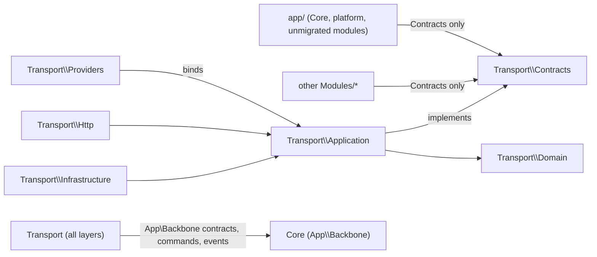

# Modules

Business modules with a clear boundary ([ADR 0016](../docs/architecture/adr/0016-module-boundaries.md),
[ADR 0017](../docs/architecture/adr/0017-module-public-contracts-and-data-ownership.md)). One application,
one deployment, one database.

```
Modules/<Name>/
    Contracts/       public API: interfaces, Contracts\Data (immutable DTOs), Contracts\Events
    Domain/          models, enums, value objects, domain rules (private)
    Application/     use cases, contract implementations (Application\Queries), policies, notifications (private)
    Infrastructure/  jobs, console commands, exports, external clients (private)
    Http/            controllers, form requests, resources, middleware (private)
    Providers/       <Name>ServiceProvider: bindings and all framework wiring, listed in bootstrap/providers.php
```



Rules, all enforced by `tests/Feature/Architecture`:

- Outside code (`app/` and other modules) uses only a module's `Contracts` (`ModulePublicApiTest`).
  Uses that existed when a module moved and could not be replaced in the same change are frozen in
  `tests/Feature/Architecture/module-internal-use-baseline.php` (today: Providers and Entitlements); that list may only
  shrink.
- Contracts are interfaces plus final data; they expose no model, builder, response, form request or
  internal class. `Illuminate\Http\Request` may pass through as request context (audit, IP), as in
  the Core's own contracts.
- Every contract is bound in the module's provider; modules do not depend on each other in a cycle.
- Every model, and so every table, has one owner in [`ownership.php`](ownership.php)
  (`ModuleOwnershipTest`). Only the owner writes it; outside code creating a module's records
  (`create`, `firstOrCreate`, `insert`, `new`) fails `ModulePublicApiTest`. Outside SQL on a module's tables is allowed only
  for the read-only readers listed in `ModulePublicApiTest`, which may not write.
- Class names from before a move live only in the bridge: [`legacy-class-map.php`](legacy-class-map.php)
  (loaded lazily by [`legacy-aliases.php`](legacy-aliases.php)) and the morph map in the module's provider.
- Inside a module: `Domain` uses only `Domain` and `Contracts`; `Application` and `Infrastructure`
  never use `Http` (`ModuleBoundariesTest`).

Progress and the order of the remaining modules: [`MIGRATION.md`](MIGRATION.md).

## Public contracts

| Module | Contract | Returns | Used by |
| --- | --- | --- | --- |
| Transport | `EmployeeTransportActivity::forEmployee($employeeId, $today)` | `Data\EmployeeTransportSummary` | My Portal |
| Transport | `TransportOperationalMetrics::snapshot($now)` | `?Data\TransportOperationsSnapshot` | system telemetry |
| Transport | `TransportDataQuality::summary()` | list of `{code, count, severity}` | data-quality report |
| Transport | `Data\TripStatus` constants | the trip status values | Situation Room reports |
| Cafeteria | `EmployeeCafeteriaActivity::forEmployee($employeeId, $today)` | My Portal's cafeteria card (array) | My Portal |
| Providers | `PortalLocationSource::selection($request)` (implemented by Cafeteria) | `Data\PortalLocationSelection` | provider-portal context |
| Providers | `ProviderRegistry::register(NewProvider, ?ProviderOwnerAccount)` | the new provider's id | Transport and Cafeteria provider registration |
| Providers | `ProviderRegistry::enableService(...)`, `updateDetails(...)` | — | Cafeteria payees |
| Providers | `ProviderPortalSession::providerId($request)`, `providerHasService($id, $code)`, `providerPayload($request)` | id, bool, layout props | Cafeteria and Transport portal pages |
| Providers | `ProviderPortalSession::actor($request)`, `can($request, $permission)`, `actorHasService($request, $code)` | `?Data\PortalActor`, bool, bool | portal scans, trips, invoices, settlement disputes, exports, form requests |
| Providers | `ProviderDirectory::offering($serviceCode, $activeOnly)`, `hasService($id, $code)`, `find($id)` | picker rows, bool, `?Data\ProviderSummary` | Transport admin pickers, form requests, services |
| Entitlements | `ServiceDeliveryRegistry::ensureServiceType(...)`, `createProvider(...)`, `recordTransaction(...)` | owned record ids | Providers service enablement and Cafeteria service-point/scan writes |
| Cafeteria | `CafeteriaTerminalScan::scan(...)` | `?Data\CafeteriaScanOutcome` | NFC API |
| Cafeteria | `CafeteriaDirectory::locations()` | list of locations | entitlement and NFC terminal pages |
| Cafeteria | `CafeteriaStaffAssignments::hasActiveAssignment($userId)` | bool | `User::hasProviderPortalAccess()` |
| Cafeteria | `Data\TransactionStatus` constants | the transaction status values | Situation Room reports |

Transport reacts to the Core's `AssignmentChanged` and `EmployeeChanged` events and reads people and
cards through `App\Backbone` contracts (`CredentialLookup`, `ServiceEligibility`, `EmployeeDirectory`).

## Moving the next module

1. Move its files with `git mv` into the layers, change their namespaces and every reference (full
   names and escaped strings in `app/`, `Modules/`, `routes/`, `tests/`, `database/`, `config/`,
   `bootstrap/`), and add `use` lines where a class was referenced unqualified because it shared the
   old namespace. Check each changed file; never a blind repository-wide replace.
2. Add every moved class to `legacy-class-map.php` under its real old name.
3. Create `Providers/<Name>ServiceProvider` and list it in `bootstrap/providers.php`: the morph map
   (`'App\Models\Old' => New::class` for each model), policies, event listeners, middleware aliases,
   rate limiters, console commands, and relations it attaches to Core models. Remove that wiring from
   `app/Providers` and `bootstrap/app.php`.
4. For each outside caller, add the contract it needs (an interface in `Contracts`, a final DTO in
   `Contracts\Data`, an implementation in `Application`, a binding in the provider) and switch the
   caller. Writes from other modules become owner commands. Declare any remaining read-only SQL reader
   in `ModulePublicApiTest` with its reason.
5. Set the module's `home` in `ownership.php`; update `MIGRATION.md`, this file and the
   [integration matrix](../docs/architecture/module-integration-matrix.md).
6. Check the production build's left-out paths (`scripts/release/build-production-branch.sh`).
7. `composer dump-autoload`, Pint, the architecture tests, the module's tests, the full suite.
