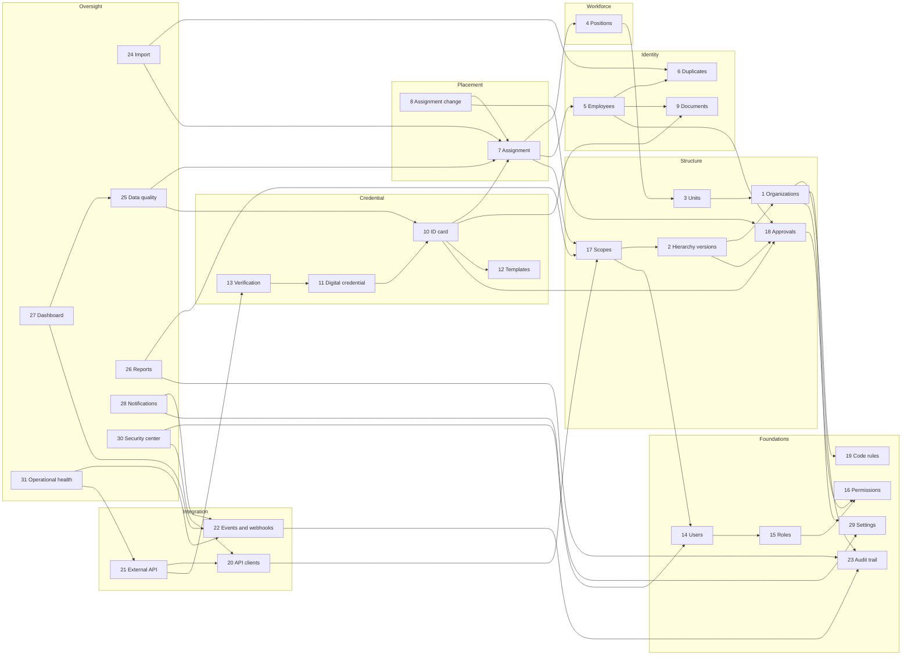

# Core Golden Path: module gap matrix and dependency map

Date: 25 October 2026. Analysis only: nothing was changed to produce it.

> **Update, later on 25 October 2026:** the P0 item and the P1 items are now
> closed on branch `feat/core-p0-p1-gate`. Those items are explicit
> organization scope, the verified-employee stage and approval, MFA, and the
> hierarchy and Integration Center screens. The rules they needed are in ADR
> 0008 (`docs/architecture/adr/0008-core-platform-p0-p1-release-gate.md`). The
> rows below describe the state before that work.

Sources read:

- **Core API**: `core-platform/backend` as of bf5adea3 (the audit commits), 100 tests passing on SQLite and PostgreSQL 18.
- **Core screens**: the EUISIS pages served by Inertia, `origin/main` e2a6fd6a (= bf5adea3 + the screens commits 17252910, b71b2e1d and e2a6fd6a + a docs commit). This replaces the hand-built SPA (parked on `feat/core-golden-path-audit-spa`).
- **EUISIS today**: classes and models present in the main application (`app/`), for capabilities that exist there but not in the Core.

Status: **Done** (built and tested), **Partial**, **Missing**, **EUISIS only** (exists in EUISIS, not in the Core).
Priority follows the brief: P0 data corruption / security, P1 Golden Path blocker, P2 identity / placement / card integrity, P3 integration reliability and structure depth, P4 audit / quality / reports, P5 UX, P6 cleanup.

## Summary

| Status | Modules |
|---|---|
| Done in the API, screens missing or partial | 2 Hierarchy versioning, 20 API clients, 22 Events and webhooks |
| Done or nearly done | 1, 3, 6, 7, 8, 13, 17, 19, 21, 23, 25, 29 |
| Partial | 4, 5, 10, 11, 14, 15, 16, 18, 27, 31 |
| Missing in the Core (exists in EUISIS) | 9 Documents, 12 Card templates, card print batches (10), 24 Import, 26 Reports, 28 Notifications, 30 Security center (MFA, break-glass) |

No open P0 item was found after the audit fixes. Four P1 items remain: the
employee verification stage, the governed hierarchy screens, MFA for privileged
roles, and the Integration Center screens. (The duplicate override on the
screens was a fifth; e2a6fd6a closed it.)

## Matrix

| # | Module | Core API (bf5adea3) | Core screens (main e2a6fd6a) | EUISIS today | Gaps | Pri. | Depends on |
|---|---|---|---|---|---|---|---|
| 1 | Organization master | **Done**: CRUD, types, statuses draft/active/inactive/merged/dissolved/archived, generated codes, leave-service guard with reasons, delete-if-never-used (soft, reason) | list, create, edit, deactivate, delete, organogram | same, plus structure import | No name history; `legal_basis_ref` not editable; `merged` does not record `merged_into_id`; leaving service does not set `effective_to` | P3 | 19, 23, 29, 2 |
| 2 | Hierarchy versioning | **Done**: draft → review → second-admin approval → publish → archived; impact counts; `?on=` history; daily snapshot for immediate edits | **read only** (index, show, tree): no create, parent change, review, approve, publish | change requests (21 classes) | Governed workflow has no screens; scheduled (future-dated) publication unsupported; only `reports_to` edges editable (no oversight, service_scope, geographically_under); impact does not list affected scope rows separately | **P1** | 1, 14, 17, 18, 23 |
| 3 | Organizational units | **Done**: CRUD, parent in same organization, no cycles, per-organization codes, active-position guard | CRUD, archive, restore | same | Unit effective dates not editable; `unit_type` text duplicates `organization_unit_type_id`; restore not re-validated (code clash, archived parent); no delete-if-unused | P4 | 1, 19 |
| 4 | Position and job structure | **Partial**: positions CRUD, codes, establishments (approved seats), occupancy derived from placements, held-position guards | positions, establishments, approve establishment | GradeLevel, Occupation, Profession, PositionMovement, PositionProfile | No grade, job level, occupation, profession, employment type or category tables (`grade_level` is free text, `occupation_id` points nowhere); status is only `is_active` (no draft/approved/vacant/occupied/suspended/abolished); no position history table (audit only) | P3 | 3, 1, 19 |
| 5 | Employee master registry | **Partial**: registration with first placement, stable UUID and number (immutable), names and gender edits, optional date of birth, phone, e-mail, national-ID hash; separation and resume (ADR 0002) | register, edit, profile | same, plus portal and corrections | **No draft / pending-verification state: an employee is active the moment it is registered, so the Golden Path "Verified employee" stage does not exist**; no official Amharic/English name fields; contacts not editable after registration; employment type and hire date not captured; photo and signature not managed in the Core | **P1** (verification), P2 rest | 4, 6, 7, 9, 18, 19 |
| 6 | Duplicate detection | **Done**: national-ID hash refused; strong (name + birth date) and possible (name, phone, e-mail) matches answer 409; override with reason, review row, audit; Data Quality check | warns once and names the matches; saving the same person again with a reason (5+ characters) sends `confirm_not_duplicate` + `duplicate_reason` (e2a6fd6a) | EmployeeDuplicateFlag, duplicate audits | No review queue or side-by-side comparison; no "confirmed duplicate" resolution; not run on edits or imports | P2 | 5, 23, 25 |
| 7 | Employee assignment | **Done**: one current placement (database-enforced), effective-date checks, history, seat capacity, scope at both ends | assignments list | same | No assignment type, primary/secondary model, source document, approved by/at; future-dated placements refused (no scheduled activation) | P3 | 4, 5, 17 |
| 8 | Assignment change | **Done**: one atomic transfer (close old the day before, open new, move pointer, seat check, audit, event) | transfer from the employee page | transfer workflows (applications, announcements) | No reason codes or source document; no approval step; no external command API (by decision, ADR 0002/0007), so no idempotency key yet | P3 | 7, 18 |
| 9 | Core employee documents | **Missing** | none | EmployeeDocument | Private storage, type/size validation, signed temporary access, versions, checksum, expiry, download audit. Also blocks photos and signatures (5, 10) | P2 | 5, 23, storage |
| 10 | Employee ID card | **Partial**: eligibility reason codes, one pending request, two-person approval, print → issue → activate, lost/damaged/suspend/reinstate/revoke, replacement lineage, renewal/correction, daily expiry | cards, card requests (create, verify, approve, reject, cancel), replace, prepare print | CardPrintBatch, IdCardPrintSnapshot | No quality-check state; no print batches, operator, spoiled cards or authorized reprint; photo rule exists but is off (no photos in the Core); the request picker offers employees by its own `eligibleTypes()` rule, while every submit and replacement is still checked by `CardRequests::eligibility()`, so the picker can offer someone the submit then refuses (calling `eligibility()` per row would cost about 12,000 queries for 1,000 rows; a set-based version is the follow-up) | P2 | 5, 7, 9, 12, 18 |
| 11 | Digital credential | **Partial**: QR carries only the public card UUID (no personal data); `qr_status`, `token_hash` columns | n/a | NfcCredential, NfcVerificationLog | Card and credential are one row: no credential entity, `key_version`, signed token or token rotation | P3 | 10 |
| 12 | Card template management | **Missing** (`card_template_id` column unused) | none | IdCardTemplate (5 classes) | Versioned front/back templates, branding, field layout, preview; issued cards keep their template version | P3 | 1, 10, 29 |
| 13 | Card verification | **Done**: person verify and client verify, ordered denial codes, holder only with employee scope, scope-limited, rate-limited, logged | ID checker (with OTP) | public ID checker | No anonymous public verification in the Core (EUISIS has it); no verification log for signed-in users (client calls are logged) | P4 | 10, 11, 7, 20 |
| 14 | Users | **Done**: create, edit, deactivate, one-time password replaced at first sign-in, password policy and history, last city-wide admin protected, sign-ins ended on access change | users, deactivate/restore, profile devices, forced password change | same, plus MFA | No MFA status, avatar or phone; see 30 for MFA | P2 | 15, 17 |
| 15 | Roles | **Partial**: three fixed roles (viewer, officer, admin) and derived city-wide admin | `CorePermissions` maps roles to EUISIS permission names | Spatie roles and permissions | Roles are not configurable; no role administration | P2 | 16 |
| 16 | Permissions | **Partial**: role checks in middleware plus scope in every action | permission names for the pages | granular permissions | No granular permissions (cards.approve / print / issue / revoke separate, users.*, settings.*); no Policies | P2 | 15 |
| 17 | Organization scopes | **Done**: subtree of the hierarchy in force, applied to every read and write, to API clients too; out-of-scope records answer 404 | scope rows UI (`users/{user}/organization-scopes`) over the single scope column | UserOrganizationScope (several scopes, fail-closed per ADR 0003) | One scope root per account; **an account with no scope is city-wide** (EUISIS fails closed instead), so forgetting the scope grants the whole city: needs a decision | P2 | 2, 14 |
| 18 | Core approval workflows | **Partial**: two-person card approval, two-person hierarchy approval | card request verify/approve; hierarchy approval not on screens | change requests | No employee verification approval (see 5); no approval on assignment change; no shared approval model or queue | **P1** (with 5) | 14, 16, 23 |
| 19 | Code rules | **Partial**: per-entity formats with `{seq:N}` and `{year}`, atomic counters, imported values skipped | code preview route | CodeRule (16 classes) | No organization-type, organization, unit or position-prefix tokens; establishment numbers use a timestamp; no print-batch numbers; no scope per organization | P4 | 29 |
| 20 | API clients | **Done**: scopes, owner organization, IP/CIDR allow list, rate limit, expiry, rotation, revocation, secret shown once, call log | **none** (Integration Center only in the parked SPA) | ExternalApplication | No screens; no per-client usage report | P1 (screens) | 17, 23 |
| 21 | External APIs | **Done**: `/api/v1/integration` organizations, positions, employees, assignment, history, status, card verify; resources, pagination, filters, error contract | n/a | v1 API with OpenAPI | No OpenAPI file (markdown guide only); no units or card-status endpoints for clients | P4 | 20, 1, 4, 5, 7, 13 |
| 22 | Integration events and webhooks | **Done**: outbox in the change's transaction, 27 event types, signed delivery, back-off retries, manual retry, event log | **none** | outbox, change feed, webhooks | No screens; no automatic disable after repeated failure; rotation ends the old secret at once (no overlap); no outbox retention | P1 (screens), P3 rest | 23 |
| 23 | Audit trail | **Done**: every change with actor, request id, IP, user agent, source, API client, old/new values, masking | audit center, audit logs | audit seals (`audit:seal`) | No tamper seal; reads, exports and file downloads not audited (none exist yet); no retention decision | P3 | none |
| 24 | Data import and migration | **Partial**: `core:import-from-euisis` whole-database copy and snapshot comparison | none | EmployeeImportBatch, OrganizationStructureImport | No business import (organizations, positions, employees, assignments, photos) with upload, preview, row errors, duplicate check, approval, queued batches | P2 | 1, 4, 5, 6, 7 |
| 25 | Data quality | **Done**: 16 checks with drill-down samples | data quality page | integrity checks | No issue lifecycle (status, resolution, resolver), severity or organization; city-wide administrators only; missing checks: no photo, missing documents, orphan references | P4 | all data modules |
| 26 | Core reports | **Missing** | none | 57 report and 28 export classes | All Core reports; scope-safe, audited, queued exports | P4 | 17, 23, queue |
| 27 | Dashboard | **Partial**: scoped counts of organizations, units, positions, employees, placements, cards; recent changes | dashboard | Core dashboard | No card coverage, expiring cards, pending approvals, data-quality, failed webhooks or security KPIs; no caching | P5 | 17, 25, 22 |
| 28 | Core notifications | **Missing** (screens have a notification feed route) | feed, mark read | 22 notification classes | Card ready, card expiring, approval needed, import done, credential rotated, security alert; Amharic and English templates | P4 | 22, 29 |
| 29 | System settings | **Done**: registry, validation, audit, cache, public subset | settings, system settings | System Settings | Missing groups: organization/employee/position rules, files, audit, notifications, API | P5 | 23 |
| 30 | Security center | **Missing** (account figures only, inside system health) | profile devices only | MfaController, ExpireBreakGlassAccess, PasswordHistory | **MFA for administrators, approvers and card officers**; failed sign-ins and lockouts view; break-glass with reason, approval, expiry | **P1** (MFA), P3 rest | 14, 20, 23 |
| 31 | Operational health | **Partial**: `GET /v1/system-health` with database, cache, storage, queue, scheduler, webhooks, API, access; backups reported as unknown | none | BackupHealth, HealthController | No screen; no backup integration; no failed-job detail | P4 | 22, 21 |

## Cross-cutting gaps

- **Localization and calendar**: the EUISIS pages bring the Ethiopian date picker; the Core API messages are English only, and there are no PDFs or exports to localize yet.
- **A second rule beside the action**: the card request picker (module 10) chooses whom to offer with its own rule. It cannot let anything wrong through, because every submit goes through `CardRequests::eligibility()`, but the two can disagree about who is offered. A set-based `eligibility()` would let the picker use the same rule.
- **Retention**: audit rows, API call logs, events and deliveries are kept forever; periods need people, not code (ADR 0007).
- **Decisions owed by people**: MFA scope and factor, retention periods, the named second approvers, and whether an account without a scope stays city-wide.

## Dependency map

Arrows point from a module to what it needs. A module is safe to build only once
what it points to is in place.

## Order this implies (when fixing starts)

1. **P1, unblock the Golden Path on the screens the city will use**: employee verification stage and its approval (5, 18); governed hierarchy screens (2); Integration Center screens (20, 22); MFA for privileged roles (30). The screens should call the existing actions, not re-implement their rules.
2. **P2, identity and card integrity**: employee documents with photo and signature (9), which then lets the card photo rule be switched on (10); granular permissions and policies (15, 16); the scope decision (17); business imports (24).
3. **P3, depth**: position master data and statuses (4); assignment type, primary/secondary and source documents (7, 8); card templates, print batches and quality check (12, 10); separate digital credential (11); audit seal (23); break-glass (30).
4. **P4 to P5, oversight**: data-quality issue lifecycle (25), reports and exports (26), notifications (28), health screen and backup reporting (31), dashboard KPIs (27), remaining settings groups (29), OpenAPI file (21).
