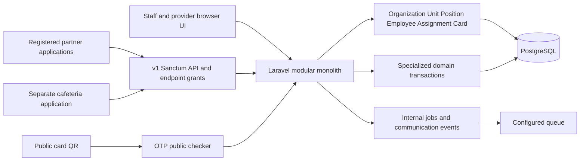
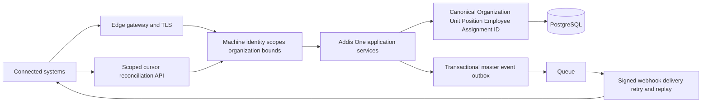

# Addis One master backbone architecture readiness audit

Audit date: 19 October 2026, Africa/Addis_Ababa. First pass at HEAD `1e7c7b07`; re-verified and completed at HEAD `cc4a44f6` (legal source register committed) with a clean tracked tree. This is an audit of the available repository and local runtime, not a certification of a deployed government environment. Every P0/P1 finding below was independently re-checked against source in the second pass; corrections from that pass are folded in rather than listed separately.

## A. Executive summary

Addis One has a substantial canonical workforce foundation: UUID master keys, an employee-to-assignment relationship, effective-dated organization hierarchy, position capacity controls, stable public card references, separate partner identities, versioned APIs, and explicit response presenters. Keep this modular monolith and build on its existing services.

It is **not ready for unrestricted city-wide backbone rollout**. Reproduced API authorization and QR-validation defects, an external-client eligibility type error, and a cafeteria consumer/provider contract mismatch block safe integration. The six provider-service routes cannot be called by a registered external application at all (they fail with a 500 and bypass the application gate), and the partner card-verification photo link points at the public `/storage/` path. Partner organization restrictions, durable master-change delivery, historical synchronization and production-scale evidence are also incomplete. These conclusions do not imply that all existing internal workflows are unusable.

The read-only PostgreSQL probe found 27 employees, 21 organizations, eight units, three positions, 27 assignments and three cards. It found zero duplicate current assignments and zero inconsistent current-assignment pointers. It confirmed the relevant partial unique indexes. These are local data-integrity observations, not concurrency or 3M capacity proof. Earlier repository load-test documentation reports 220,000 employees on a developer laptop; it is useful prior evidence, not a current production benchmark.

Deliverables: [machine-readable checklist](addis-one-master-backbone-audit.json), [ownership matrix](data-ownership-matrix.md), [API inventory and readiness](api-integration-readiness.md), and [dependency-ordered roadmap](master-backbone-remediation-roadmap.md).

## B. Overall architecture maturity score

**60/100**, an evidence-weighted engineering assessment, not a statistical measurement or compliance certificate. Safety blockers override the numerical score. Weights are the suggested ones, unchanged.

| Area | Weight | Awarded | Basis |
| --- | ---: | ---: | --- |
| Master data authority | 20 | 17 | Shared core records; legacy office and account overlap need governance |
| Identity integrity | 15 | 12 | UUIDs and database uniqueness present; external consumer loses UUID and QR semantics diverge |
| Assignment and position | 10 | 8 | Transactional transfer and one-current index; capacity/history contract gaps |
| API architecture | 15 | 8 | v1, bounded lists and presenters; consumer mismatch, provider routes unusable by machine clients, no machine-readable schema or complete sync |
| Security | 15 | 6 | Independent clients, grants and throttles; reproduced boundary bypass and QR defect |
| Events and webhooks | 10 | 1 | Internal after-commit work exists; no durable partner change-delivery pipeline found |
| Scalability and availability | 10 | 5 | Indexes, deployment support and prior partial measurements; target not measured |
| Governance and documentation | 5 | 3 | Substantial documentation; institutional decisions and contract enforcement incomplete |
| Total | 100 | 60 | |

## C. System-of-record readiness

“Today” here means safe authoritative use across the intended city-wide integration boundary, including historical interpretation and access control. All six entities have an identifiable canonical source; the verdict is not a claim that six replacement masters are needed.

| Entity | Verdict | Evidence and remaining condition |
| --- | --- | --- |
| Organization | PARTIAL | `Organization`, edges, closure paths and hierarchy versions; partner organization restrictions and historical contract incomplete [E1,E5,E8] |
| Unit | PARTIAL | `OrganizationUnit` and types; mutable parent plus legacy office reference, no complete versioned unit API [E5,E6] |
| Position | PARTIAL | UUID slot definition, establishment capacity, profiles/JDs; API vacancy meaning differs from available capacity; archiving can leave active assignments [E6,E7] |
| Employee | PARTIAL | Canonical `Employee`, unique number and national-ID hash; directory access boundary and account-copy governance unresolved [E1,E2,E8,E9] |
| Assignment | PARTIAL | UUID history, locked transfer, current pointer and DB unique index; transfer lacks JD pin and reuses old hierarchy version [E3,E4] |
| ID card | PARTIAL | Separate physical-card/public-reference identities and lifecycle; partner QR check disagrees with service eligibility [E10,E11] |

## D. Master data findings

The foundation migration and models establish one core `organizations`, `organization_units`, `positions`, `employees` and `employee_assignments` set. Searches of models and migrations did not find a separate cafeteria/transport staff master. Transaction snapshots, assessment eligibility snapshots, proposed designs, duplicate-review flags and histories are legitimate domain records; they must not become write authorities for the core entity.

`InstitutionOffice` is a legacy parallel representation, not a reason to create another organization master. The deprecation tests show legacy creation routes creating `OrganizationUnit`; the unit model still carries `institution_office_id`. Preserve the compatibility mapping until usage and data reconciliation prove it removable. `PositionProfile`, `JobDescription`, establishments and design proposals describe versions, capacity or proposed changes to a position, not a second employee master. [E1,E6,E7,E16]

Canonical writes are distributed through named Actions and domain services rather than a single `EmployeeService`. Registration, imports, transfer, web update, self-service review and approved organizational changes must be treated as a command inventory. Ordinary internal Eloquent relationships are appropriate in this monolith. The external cafeteria uses HTTP; no direct external connection to the Addis One master database was found in its reviewed configuration/client code. Infrastructure-level DB grants were not inspected. [E2,E3,E15,E16]

## E. Identity and identifier findings

Core `id` columns are PostgreSQL UUIDs. `HasUuidPrimaryKey` generates UUIDv7 for new records. An API field called `id` is therefore **not an exposed auto-increment integer**. Keep these IDs, formally promise immutability/non-reuse, and document them as integration identifiers; do not add duplicate UUID columns merely to change a field name. IDs are excluded from the reviewed master model fillable lists. Database-wide immutability enforcement is not established. [E1]

Employee number remains the unique business/display key. The separate cafeteria stores it in transactions and subsidy ledger rows and uses it for duplicate-service decisions. These are valid snapshots but insufficient durable machine linkage: add canonical employee/organization UUID references non-destructively and keep the original number/name snapshots. Card verification currently does not return an employee UUID, which directly causes F3. National ID must not become a partner key. [E2,E10,E15]

`User` has authentication/profile attributes, encrypted national ID/phone and an employee link. Legacy email matching and pinning coexist with `employee_id`; they are not a separate employment authority, but two independently editable identity/profile representations need a field-ownership decision. `ProviderUser` is a separate provider authentication identity and should remain so. [E16]

## F. Organization hierarchy findings

Organization types, units/types, hierarchy versions, edges, closure paths, effective dates and structural/functional relationship types exist. Edge mutation validation, publish-time cycle detection and subtree scope services are real behavior, not inferred from names. The configured hierarchy can represent city/bureau/sub-city/woreda levels; this audit does not certify the completeness of the local city's hierarchy data. [E5]

Historical organization edges and current mutable unit parents are different mechanisms. `HierarchyVersionResolver::resolveDefault()` selects the latest published version by `effective_from` and falls back to a draft; it does not filter `effective_from <= today`, so a future-dated published version becomes "current" early, and it is not an arbitrary-date resolver. As-of logic exists only ad hoc (for example `PositionCapacityService::approvedSlotsForPosition(..., $onDate)` and forecasting `vacanciesAsOf()`). Publishing checks edges as a graph without separating relationship type in its duplicate/cycle projection. Validate institutional semantics for functional relationships before reusing that projection as an external structural contract. The current integration presenter omits hierarchy version/effective context for organization and unit records. A historical query cannot be safely promised merely because version tables exist. [E5,E8]

## G. Position and assignment findings

Registration locks the destination position, checks capacity, creates the employee and assignment, sets the current pointer, writes status history and audit within a transaction. Transfer completion locks the application, employee, assignment and destination; refuses premature implementation, closes the old inclusive interval the previous day, creates a new assignment, moves the pointer and occupancy, updates agreements/reprint context, and preserves employee UUID/number. A repeated completed transfer returns the existing outcome. [E2,E3]

The database has `employee_assignments_one_current_per_employee WHERE is_current = true`. Application transactions and row locks complement it. This enforces **at most one** current assignment, not that every employee has exactly one, that the pointer belongs to the employee, or that all historical intervals are non-overlapping. The local probe found no pointer violations; a concurrent PostgreSQL writer test was not run. [E4]

Position capacity is approved establishment slots, falling back to one, with active current assignments as occupancy authority. `PositionOccupancy` is a rebuildable establishment ledger. Do not declare it a competing employee master. However, legacy `availableSlotsForPosition()` uses occupancy rows, whereas placement uses current assignments. The external presenter labels any position with a current assignment `vacant=false`, ignoring additional approved slots and assignment status. Publish distinct occupied-count and available-slot semantics after a policy decision. [E7,E8]

`CompleteTransferAction` copies the old `hierarchy_version_id` and does not populate `job_description_id` on the new assignment. The parallel `CompleteVacancyTransferAction` copies the hierarchy version the same way and also omits `organization_unit_id`, which the transfer action does set, so vacancy-driven moves lose unit context on the new assignment row. Although the assignment model supports JD pinning and profile/JD versions exist, transfer does not establish the destination's in-force context. `ArchivePositionAction` and its controller/policy do not block active assignments or close them. This preserves rows but can make the current assignment's normal position relation disappear through soft deletion. Treat both as P1 history/integrity risks, without rewriting transfer rules during this audit. [E3,E6]

## H. ID card and QR findings

Employee UUID, employee number, card row UUID, `public_card_uuid` and legacy secret-bearing card token are distinct. `CardQrPayloadService::ensurePublicReference()` preserves an existing public UUID; explicit rotation/replacement are different lifecycle operations. Printed QR contains an opaque URL/reference, not embedded HR or service data. Preserve existing references, payload versions, reprints, replacement chains and historical snapshots. [E10]

The active public route is `PublicIdCheckerController`: pre-consent output contains card-state flags and a masked card number; holder fields follow an OTP check. `/verify/card/{publicCardUuid}` redirects to it. The old `CardPublicVerifyController` is **not the routed verification handler** and must not be used to claim current public PII exposure. No public national-ID/phone disclosure was demonstrated. [E11]

Partner verification uses a separate controller. It checks active status, expiry and `revoked_at`, but not `qr_status` or `is_current`; a synthetic active card with `qr_status=revoked` returns `valid=true`. The public checker and eligibility service apply different checks. Define separate `card_valid`, `employee_active` and `service_eligible` meanings; a valid-looking card must not imply service authorization. **F17 — P1.** The partner photo URL is built as `url('storage/'.$employee->photo_path)` (`IdCardVerificationApiController::photoUrl()`), an unsigned, permanent public-disk link. New uploads live on the private disk under `employee-photos/` and are served by the authorized `employees.private-photo` route, so for them the link is broken; legacy photos still on the public disk are world-readable to anyone who obtains the link. Use an approved short-lived signed media contract. Do not solve it by making photos public. [E10,E11,E12]

## I. Specialized module boundaries

| Module | Boundary classification | Integration dependency quality |
| --- | --- | --- |
| Organization / units | PARTIAL_DUPLICATION | Canonical units plus legacy office compatibility; PARTIAL |
| Employee | PARTIAL_DUPLICATION | Canonical employment master, account profile copies; PARTIAL |
| Position | CORRECT_DOMAIN_BOUNDARY | Profiles, JDs and capacity reference canonical position; PARTIAL semantics |
| Assignment | CORRECT_DOMAIN_BOUNDARY | Canonical employee-position placement; GOOD internal / PARTIAL external history |
| ID card | CORRECT_DOMAIN_BOUNDARY | Consumes employee/assignment and print snapshot; PARTIAL verification |
| Internal cafeteria | CORRECT_DOMAIN_BOUNDARY | Employee/card/organization references and own consumption/settlement; GOOD identity dependency |
| External cafeteria | CORRECT_DOMAIN_BOUNDARY | Transaction snapshots, no competing HR table; LOW contract readiness because of F3/F4 |
| Transport | CORRECT_DOMAIN_BOUNDARY | Passes/transactions reference Employee, own routes/trips/vehicles/drivers; GOOD identity dependency |
| Performance | CORRECT_DOMAIN_BOUNDARY | Agreements reference employee, assignment, organization and position; GOOD identity dependency |
| Daily work / field work | CORRECT_DOMAIN_BOUNDARY | Logs/requests pin employee and assignment context; GOOD identity dependency |
| Transfer | CORRECT_DOMAIN_BOUNDARY | Changes assignment, preserves person; PARTIAL historical context |
| Public feedback | CORRECT_DOMAIN_BOUNDARY | Canonical targets plus submission-time context; GOOD identity dependency |
| Grievance / discipline / appeal | CORRECT_DOMAIN_BOUNDARY | Cases, parties and decisions are transactional records; GOOD identity dependency |
| Recruitment / vacancy | CORRECT_DOMAIN_BOUNDARY | Vacancies are internal mobility only: `vacancy_applications.employee_id` is a required FK to `employees`, no Applicant model exists; employees are created only by `RegisterEmployeeAction` and `OrganizationStructureImportService`. External recruitment onboarding NOT_IMPLEMENTED |
| Situation Room / intelligence | CORRECT_DOMAIN_BOUNDARY | Scoped aggregates and explanatory outputs; GOOD derived-data boundary |

“GOOD” describes the inspected identity dependency, not production certification of every feature. No dangerous competing employee master was established. Future applicant identity is not automatically employee identity; convert an approved hire through a governed onboarding command. A standalone tribunal integration is not implemented (`court_cases` is a disabled placeholder), so its readiness is NOT_IMPLEMENTED. Assistant metric/health tools read scoped data and write their own audit records, not authoritative HR changes. [E15–E18]

## J. API current-state inventory

`route:list --json` returned 1,504 routes, including **28 `/api/v1` endpoints**. The complete method/path/auth/scope/response/privacy inventory is in [API readiness](api-integration-readiness.md). Browser `/api/organization-unit-types/options` is session/admin UI support, not an unversioned partner master API. Master organization/unit/position/employee/assignment endpoints are read-only. No generic partner employee/org/position CRUD write endpoint was found. NFC/provider service writes are domain commands, not master CRUD. [E8,E13]

## K. API security findings

**F1 — P0, reproduced authorization defect.** `EnsureApiScope` treats `provider:access` and `*` as satisfying every scope; `ExternalApplicationGate` passes non-application users through. Directory controllers do not perform a human policy check. A user with only a legacy provider token can read an arbitrary employee via `/api/v1/employees/{employee}`. The audit evidence test returns 200 without HR permissions. Require a supported principal type and explicit policy/scoped resource authorization; isolate provider backward compatibility to provider routes. [E8,E9,E12]

**F2 — P1, policy capability gap.** Registered clients have no organization binding, and existing SEC-010 tests deliberately prove global organization/employee reads. This is the documented blast radius of a grant, not a demonstrated bypass of an existing organization ACL. It is unacceptable for organization-restricted partners unless city-wide access is explicitly approved. Implement organization/subtree bounds where required; do not silently narrow existing approved consumers without migration. [E9]

**F3 — P0, consumer/provider mismatch.** Verification omits employee UUID; external `ServeEmployeeService` only calls eligibility when the UUID is present, then can write `eligibility_result=eligible`. Its mock fixture invents `employee_id`. Missing contract data must deny service; add the actual canonical UUID and a shared contract fixture. Combined with F5, a revoked QR can reach service without the intended eligibility gate. [E10,E15]

**F4 — P1, reproduced availability defect.** The external eligibility controller passes an `ExternalApplication` to `EmployeeServiceEligibilityService::check(?User $actor)`, causing a `TypeError`. Fix actor/audit typing deliberately rather than impersonating a human administrator. Provider middleware also assumes `hasRole()` and a human organization-scope relation, so the old provider transaction route is not a drop-in external-application API. [E12,E13]

**F5 — P0, reproduced QR revocation mismatch.** An active card with a revoked QR remains `valid=true` in partner verification. Use shared credential-state checks and test current/replaced/revoked QR, card and employee states separately. [E10–E12]

**F16 — P1, provider-service routes are human-token only.** Six v1 routes (`cards/verify`, `employees/{employee}/entitlements`, `offline-sync/transactions`, `providers/{provider}/settlements/{period}`, `services/{serviceType}/authorize`, `services/{serviceType}/transactions`) run `EnsureProviderServiceScope` instead of `ExternalApplicationGate`. That middleware calls `$user->hasRole()`, which `ExternalApplication` does not have, so a registered application gets a 500. For User tokens these routes skip the endpoint grant, IP allowlist, per-application limit and `api_request_logs` row. In offline sync, `provider_code` is read top-level while the request carries it per item, so the provider-scope check is skipped entirely. Move these routes onto the application gate with a machine-principal provider binding. [E13]

**F18 — P2, provider settlement ignores the period.** `GenerateSettlementReportAction::execute($provider, $period)` sums every settled transaction for the provider and only echoes `$period` back. A partner reading `/providers/{provider}/settlements/2026-10` receives an all-time total labelled as one period. **F19 — P2:** `ServiceTransactionController` picks the employee's first `Entitlement` for the service type without active-status or date filters. [E13]

Positive controls verified: the four `/api/v1/nfc/*` routes also run `NfcApplicationGate`, which requires the exact scope in both `allowed_scopes` and the token, so the `*`/`provider:access` wildcard does not reach them. `ExternalApplication` tokens can only be issued with `ApiScope` enum values, so the F1 wildcard is reachable through User and legacy tokens, not through newly registered applications. `/api/v1/id-cards/verify/{token}` is separate from the public QR checker (`/verify/card/{publicCardUuid}` → OTP-gated `PublicIdCheckerController`).

## L. API versioning findings

Path versioning is COMPLIANT. Lifecycle/deprecation discipline is PARTIALLY_COMPLIANT: existing `/organizations` is deliberately retained beside richer `/organizations/directory`, but no enforced versioned schema/sunset mechanism was found. Preserve old field names and scopes while adding safe fields; semantic corrections such as vacancy, eligibility and scope tightening need migration notices and regression tests. [E8,E14]

## M. API contract findings

The shared organization presenter and verification resources explicitly select/serialize fields. Directory responses exclude national ID, phone, email, salary and documents. Bilingual names and ISO-formatted update timestamps exist; assignment dates are Gregorian date strings. Status values expose internal enum strings, so freeze/document the published vocabulary. Error bodies differ among framework handlers (`{message,status,error_id}`), scope/gate responses (`{message,error_code[,required_scope]}`), provider middleware (`{message}`), NFC results (`{valid,eligible,reason_code}`), card 404 (`{valid,status,error_code}`) and Laravel validation (`{message,errors}`). The API catch-all returns a generic 500 without traces even in debug mode; `DomainException` messages are passed through with 409. CORS (`config/cors.php`) filters out `*`, defaults to no origins and sets `supports_credentials=true`; its `allowed_headers` omits `Idempotency-Key` and `X-Request-ID` and nothing is exposed, so browser clients cannot use those headers. `updated_after` accepts Carbon-parsable input rather than strictly ISO-only input. [E8,E13,E14]

No OpenAPI/Swagger artifact was found outside dependencies. Markdown endpoint documentation and catalog discovery exist, so the gap is machine validation, not absence of documentation. Employee basic responses already embed assignment data; granting the separate assignment scope is not the sole way to receive that context. Review scope-to-field promises, especially gender and nested structure employee summaries. The cafeteria mismatch is evidence that independent mocked tests are not provider/consumer contract tests. [E8,E14,E15]

## N. Machine-to-machine authentication findings

Sanctum bearer tokens against `ExternalApplication` provide real machine principals, independently revocable credentials and known scope lists. OAuth2 client credentials is NOT_IMPLEMENTED/NOT_READY; no Passport/OAuth authorization server was found in Composer requirements or routes. This is a future federation capability, not automatically a defect in a bounded Sanctum deployment. Decide issuer/audience, short-lived credential issuance and operational rotation needs before introducing OAuth. [E9,E14]

## O. Service client and scope findings

API Management supports registration, endpoint assignment, token issue/revoke, suspension, IP allowlists, per-client limits, request logs and soft-delete offboarding that removes tokens/grants. Multiple clients do not need a shared global token. Creating a replacement token before revoking the old one supports overlap. Default Sanctum expiry is eight hours; there is no demonstrated automated partner refresh/rotation flow. [E9,E14]

Endpoint grants are deny-by-default for new applications, with explicit legacy unrestricted-endpoint grace. Inventory and retire that grace by owner-approved migration. `allowed_scopes` is used at token issuance; `EnsureApiScope` checks token abilities. Endpoint removal does revoke access through the gate, but an isolated scope-field edit should not be assumed to revoke every already-issued capability. Test effective grants after every management change. [E9,E14]

## P. Event and webhook findings

**Event/webhook readiness: NO for partner master-data propagation.** Existing events are mainly communication broadcasts and backup alerts. Assignment changes trigger an internal communication-membership job with `afterCommit()`. Audit event enum names are not a durable public event stream. No master-event outbox, partner subscription dispatcher, signing-key rotation, delivery history, replay cursor or dead-letter workflow was found. `callback_url` alone is not a webhook implementation. [E19]

Keep internal Laravel events/jobs. For committed employee/status/assignment/card changes that must reliably reach partners, a transactional outbox is justified: polling mutable tables alone cannot represent all dependent changes, revocations and deletions. A database outbox and queue worker are sufficient as a first design; Kafka/RabbitMQ are not justified by the inspected evidence.

## Q. Integration reliability findings

**F6 — P1:** `EnforceIdempotencyKey` is optional cache replay after success, without atomic claim, request-body fingerprint or durable result. Concurrent requests can both execute; a changed payload can replay the earlier result; token rotation changes the namespace. Business-reference uniqueness in service transactions helps but is not a universal request-idempotency guarantee. External cafeteria uses an existence lock without a unique employee/cafeteria/service/day constraint; absence-row locking does not prove duplicate prevention. [E13,E15,E20]

**F7 — P1:** `/offline-sync/transactions` verifies each submitted transaction (writing a `CardVerification` row per item) but never calls the service-transaction recording action. Its request validator has `['required','array','min:1']` with no maximum batch length. Do not advertise it as durable ingestion or reconciliation. [E13]

**F8 — P1:** `updated_after` plus offset pagination is partial incremental sync. Nested organization/position changes need not touch `employees.updated_at`; soft-deleted organizations, units and positions disappear from lists (employees, assignments and cards are not soft-deleted and expose status instead); no tombstone feed or snapshot high-watermark is exposed. No complete arbitrary-date assignment/structure API exists. Use a stable `(change_version, id)` cursor or change journal with scoped tombstones, bounded batches and reconciliation. Keep all-history exports controlled, never ordinary full-database access. [E8,E19]

Partner outages do not currently roll back employee/assignment writes because no synchronous partner dispatcher was found. The external cafeteria times out HTTP calls and denies network failures, but F3 contradicts its claimed fail-closed eligibility handling. Queue `after_commit=false` defaults mean new integration jobs must explicitly use after-commit/outbox dispatch. [E15,E19,E21]

## R. Data governance findings

The system is MDM-like, but institutional ownership is not established by models or role names. Approve an owner/steward, canonical fields, permitted change commands, matching/merge process, public-field approval and partner purpose for each master. Retain existing role, policy, audit and controlled change-request structures. Do not install a separate MDM platform before proving a need. [E2,E5,E16,E22]

Reference data belongs to Addis One: organization/unit types, grade levels, occupations, professions and classifications. A position's legacy grade string and versioned profile fields need published mapping rules. No fabricated ISCO/ISIC/CPC values should be exposed; imported/approved catalog provenance must accompany any future reference API. Formal payroll, attendance, training and tribunal data-sharing authority remains NEEDS_POLICY_DECISION.

## S. PII and privacy findings

National ID is encrypted on employee write, hidden in model serialization, and searched with a deterministic hash with a unique partial index. The employee accessor still accepts legacy plaintext when decryption fails; stored-data remediation completeness was not verified by reading personal values. User phone is encrypted, while employee phone is an ordinary attribute. No claim of blanket database encryption or production TLS validation is made. [E2,E4,E16]

Audit redaction protects national ID, credentials and OTP fields recursively, but `RegisterEmployeeAction` logs a full employee array and the redaction list contains `phone_number`, not employee `phone`, email, address or DOB. This is unnecessary duplication unless an approved audit purpose requires those fields. `WriteAuditLogAction` creates a fresh request ID instead of using the inbound correlation ID. External API logs correctly store route templates rather than bodies; the cafeteria client logs concrete verification paths containing the public QR reference. Minimize and restrict those records. [E2,E15,E22]

Proposed field classes, pending institutional approval: PUBLIC = pre-consent card-state response; INTERNAL = approved organization/reference fields; CONFIDENTIAL = employee names/numbers/assignment/photo; RESTRICTED = national ID, credentials and sensitive HR/case data. These are engineering proposals, not legal classifications. Retention configuration exists and excludes master/assignment history from generic pruning; legally approved schedules and holds must be verified with the data owner. [E11,E22]

## T. Scalability findings

Directory lists cap page size at 100 and eager-load bounded assignment context. `updated_at`, employee number, UUID and card lookup indexes exist. Offset pagination/count queries remain costly for deep synchronization. Organization structure rejects excessive positions/occupants above its configured 10,000-node limit, but units alone are always loaded and excluded from that count. Cap all node types, prefer flat cursors for large organizations, and measure before adding indexes. [E4,E8]

Static searches found raw employee SQL in controlled scale generation, encryption/audit commands and aggregate readers; that alone is not unsafe external DB coupling. No literal `Employee::all()` or `Organization::all()` was found in that search. It does not prove every `get()` bounded. The reviewed structure and offline batch paths have concrete remaining bounds issues.

## U. Load balancer, Redis and queue readiness

Code supports Redis, database sessions/queues, shared S3 private/public storage and scheduler `withoutOverlapping()->onOneServer()` locks (all 20 scheduled entries in `routes/console.php`). `.env.example` defaults are `CACHE_STORE=database`, `SESSION_DRIVER=database`, `QUEUE_CONNECTION=database`, `FILESYSTEM_DISK=local`; the local runtime currently uses file cache, database sessions/queues and local disks. The `api` rate limiter (`AppServiceProvider`, 120/min default, keyed by principal or IP) and the idempotency cache both use the default cache store, so their correctness across nodes depends on that store being shared. Copying that configuration to independent app nodes would not establish distributed throttling/idempotency/locks or shared media. Deploy shared cache/lock storage and storage disks, verify trusted proxy settings, and budget worker timeouts below retry-after. [E21]

Read replicas/PgBouncer are not demonstrated running. Introduce pooling when the agreed HTTP/queue worker budget exceeds safe DB connections; test transaction-pooling compatibility. Keep immediate post-command reads and credential revocations on the primary unless lag behavior is explicitly designed. Existing capacity-plan PgBouncer sizing is a scenario, not measured production configuration. [E23]

## V. Database and index findings

PostgreSQL 18.6 is reachable. The probe ran inside a READ ONLY transaction with a 10-second statement timeout. UUID PKs, unique employee number, unique national-ID hash, unique public-card UUID, one-live-current-card and one-current-assignment indexes are present. Employee/current, organization/current and position assignment indexes are present. Core migration relationships were reviewed; no schema was changed. [E1,E4]

Representative `EXPLAIN` for UUID lookup and recent employee directory scan chose sequential scans on the 27-row table, with a sort for employee number. This is reasonable at that size and proves neither a missing index nor target-scale performance. With `enable_seqscan=off` in the same read-only transaction, the planner used `employees_pkey` (UUID), `employees_employee_number_unique`, `id_cards_public_card_uuid_unique`, `employee_assignments_one_current_per_employee` (current assignment), `positions_pkey`, `organization_units_pkey` and `employees_updated_at_idx` with an incremental sort on `(updated_at, id)` for a sync page. All seven identity/sync lookups therefore have an index path; no new index is recommended without target-scale evidence. `pg_indexes` confirms these are `UNIQUE`: employee number, national-ID hash (partial), card number, public card UUID, token hash, one live current card, one current assignment, organization code, position code, unit `(organization_id, code)` and service-transaction provider reference. Larger explain/analyze, write concurrency, FK validation and interval-corruption probes are still needed on an isolated representative environment. Two legal-source migrations were pending; `migrate --pretend` succeeded. Their presence means source and local schema are not identical.

## W. Observability findings

Request correlation middleware, metadata-only partner logs, error logging, request telemetry, health routes, API Management, Intelligence and backup monitoring exist. Do not recommend recreating them. Remaining integration gaps include consistent request ID linkage across audit/API records, logging exception outcomes that bypass middleware's post-response code, per-client latency/SLO reporting, and webhook delivery health after such delivery exists. Logging on every request and updating `last_used_at` are write costs to measure. [E9,E21,E22]

## X. API gateway readiness

**RECOMMENDED_BEFORE_EXTERNAL_ROLLOUT**, after application authorization/contract repairs. TLS termination, route limits, approved origins and trusted proxy configuration can sit at an edge gateway; no specific commercial gateway or new service split is required. A gateway cannot repair F1/F3/F5 or enforce resource ownership the application never models. Browser CSRF remains enabled; machine APIs use bearer authentication. CORS/credential behavior and proxy-origin trust require deployment verification; no permissive credentialed wildcard configuration was established. [E8,E21]

## Y. Three-million-employee readiness

**PARTIAL — not demonstrably ready for 3,000,000 employees.** Repository documentation reports a 220k-employee laptop benchmark, including a 7–11-second first city-wide dashboard computation, but lacks current 3M partner-sync, scan-write, queue/outage and failover measurements. This audit did not seed or stress the active database. Before acceptance, run isolated 3M tests with realistic cardinalities, simultaneous partners, cold/warm caches, revoked credentials, deep sync, one-node loss and queued catch-up. Agree SLOs/RPO/RTO first. [E23]

## Z. P0, P1, P2 and P3 gaps

| ID | Priority | Kind | Gap |
| --- | --- | --- | --- |
| F1 | P0 | Reproduced code defect | Provider token bypasses directory-specific permissions |
| F3 | P0 | Code/contract defect | Cafeteria skips eligibility on real verification payload |
| F5 | P0 | Reproduced code defect | Revoked QR accepted by partner verification |
| F2 | P1 | Policy and capability gap | No partner organization restriction |
| F4 | P1 | Reproduced code defect | External principal fails eligibility actor type |
| F6 | P1 | Reliability defect | Non-atomic replay cache / missing satellite uniqueness |
| F7 | P1 | Contract defect | Offline-sync verifies without recording; unbounded batch |
| F8 | P1 | NOT_IMPLEMENTED | Complete change cursor, tombstones and historical contract |
| F9 | P1 | NOT_IMPLEMENTED | Durable master events, webhook delivery/replay |
| F10 | P1 | Integrity/semantic risk | Capacity disagreement, archive guard, transfer and vacancy-transfer context |
| F16 | P1 | Code defect | Provider-service routes 500 for application tokens, bypass the gate; offline-sync skips provider scope |
| F17 | P1 | Privacy/contract defect | Partner photo link is an unsigned public `/storage/` URL |
| F11 | P1 | Operational proof gap | Shared production topology, 3M load and recovery exercise |
| F12 | P1 | Dependency finding | npm reports critical/high dependency advisories; assess reachability and update |
| F13 | P2 | Privacy/observability debt | Audit PII copies, correlation mismatch, photo contract |
| F14 | P2 | Contract hardening | Error/enum/ISO rules, OpenAPI and consumer tests |
| F18 | P2 | Code defect | Settlement API ignores the requested period |
| F19 | P2 | Code defect | Service transaction picks first entitlement without active/date filter |
| F20 | P2 | Semantic defect | Hierarchy resolver treats a future-dated published version as current |
| F15 | P3 | Future enhancement | OAuth federation, replicas or bounded-context extraction when justified |

No proven competing employee master, public national-ID leak or external unrestricted DB grant is asserted. Findings about those would require additional evidence.

## AA. What should not be changed

Keep the modular monolith, existing UUIDs and employee numbers, card QR references and print history, assignment history, approved establishment capacity, canonical model relationships, domain-owned transaction snapshots, explicit API presenters, v1 compatibility path, independent external applications, provider-user separation, OTP public-checker boundary, database unique indexes, scoped aggregate tools and existing operational tooling. Do not re-key rows, regenerate cards, replace working domain rules or require Kafka/microservices to satisfy an architecture diagram.

## AB. Immediate remediation

Contain affected partner/provider access; repair F1, F3 and F5; repair F4 so eligibility actually runs for machine principals; stop returning the public `/storage/` photo link (F17); use exact provider responses in cafeteria contract tests. Do not broaden directory scopes simply to work around missing verification fields. Triage npm advisories separately from application exploitability. The [roadmap](master-backbone-remediation-roadmap.md) states prerequisites, effort and acceptance evidence.

## AC. Phase A remediation

Approve partner organization/field policies; publish existing UUID guarantees; complete principal-aware grants, effective revocation and controlled write authority; reconcile position/assignment/card semantics; define schemas for existing v1 and preserve old consumers.

## AD. Phase B remediation

Add durable idempotency, bounded ingestion, change journal/outbox, signed delivery and scoped reconciliation. Add tombstones/version cursors and historical read semantics after data-history correctness is proven. Deploy and exercise shared cache/storage/queues and recovery. Keep event payloads minimal and partner outages asynchronous.

## AE. Phase C remediation

Run representative 3M and failure tests; enforce agreed SLOs and connection budgets; onboard one partner with revocation, credential rotation and recovery drills; stage gateway rollout and consumer migration. Do not label the whole city ready after a small read-only pilot.

## AF. Future architecture

One authoritative organization/workforce/identity core remains inside Addis One. Specialized applications own service transactions/cases/applications and consume approved references. A governance layer defines change rights without duplicating tables. Future service extraction candidates are notification/delivery or heavy reporting only if operational measurements justify independent scaling; neither is a prerequisite now.

## AG. Recommended API v1 shape

Preserve existing organization/unit/position/employee/current-assignment paths and UUID `id` semantics. Add version/effective metadata and bounded change feeds compatibly; provide as-of assignment/structure/JD reads only after historical guarantees exist. Verification should return canonical employee/card identifiers plus explicitly defined validity/active flags and only approved display data. Eligibility remains a domain-specific decision, not inference from a broad HR response. Reference-data reads should be narrow and provenance-aware. Future recruitment writes should be approved onboarding commands with idempotency and audit, not generic CRUD. [API details](api-integration-readiness.md)

## AH. Recommended event v1 shape

Minimum events: `employee.created`, `employee.updated`, `employee.status.changed`, `employee.assignment.changed`, `employee.transferred`, `organization.created`, `organization.updated`, `organization.structure.changed`, `position.created`, `position.updated`, `position.status.changed`, `id-card.issued`, `id-card.revoked`; include archive/supersession changes under explicit status semantics. Envelope: event UUID, type, schema version, aggregate UUID/version, occurrence/effective timestamps and correlation ID. Payload: approved changed fields or references, never full model serialization. Persist with the domain commit, deliver at least once, deduplicate by event UUID, enforce per-aggregate ordering/version checks and reconcile gaps. Signing timestamp/key ID, replay limits, retries with backoff/jitter, failed-delivery history and operator replay are necessary before claiming webhook readiness.

## AI. Recommended integration scopes

Keep current names (`organizations.read`, `organization_units.read`, `positions.read`, `employees.basic_read`, `employee_assignments.read`, `organization_structure.read`, `id_cards.verify`, `service_eligibility.check`) where already contractual. Couple each to organization/field/purpose bounds. Cafeteria/transport normally need verify + service eligibility and their own transaction command, not general employee directory, salary, performance or discipline access. Tribunal needs approved employee/organization lookup while owning cases. Attendance/training reference employee UUID and necessary assignment context; payroll requires a separately approved sensitive contract. Do not grant broad `provider:access` as an alias for these permissions.

## AJ. Current and target architecture

Current, from routes, models and reviewed clients:

Target; gateway and partner event delivery are proposed, not claimed installed:

| Area | Current | Target | Gap / risk | Priority | Action |
| --- | --- | --- | --- | --- | --- |
| Core identity | UUID canonical models | Same IDs with immutable contract | Satellite omits UUID | P0/P1 | Repair F3, preserve keys |
| Authorization | Scope/grant checks with provider wildcard | Principal and resource authorization | Directory exposure | P0 | F1 then organization grants |
| Verification | Multiple validity implementations | Consistent credential semantics | Revocation disagreement | P0 | F5, contract tests |
| Assignment | Current/history and locks | Preserved destination effective context | JD/hierarchy and archive gaps | P1 | F10 |
| Sync | Offset updated-after reads | Ordered cursor + tombstones | Missed dependent changes | P1 | F8 |
| Events | Internal notifications | Durable signed partner events | No replay/delivery | P1 | F9 |
| Operations | Config support and local defaults | Tested shared topology | Scale/recovery unproved | P1 | F11 |
| Contracts | Markdown and explicit presenters | Machine schemas + consumer validation | Mock drift | P1/P2 | F3/F14 |

## AK. Data ownership matrix

See the [complete ownership matrix](data-ownership-matrix.md), including canonical tables, command paths, archive behavior, readers/writers and synchronization ownership. It distinguishes system of record, engagement, derived data, cache/copy and transactional satellites.

## AL. Risks and policy decisions

| Threat | Present control | Residual issue / required decision |
| --- | --- | --- |
| Stolen partner credential / impersonation | Hashed tokens, per-client revocation, limits/IP options | Approve rotation, network restrictions and least-data grants |
| Overprivileged client / IDOR | Endpoint and ability grants | F1 bypass; F2 missing organization dimension |
| Scraping / cache leakage | Rate limits, bounded lists, scoped internal aggregate keys | File cache is node-local; global directory grant can enumerate city data |
| PII overexposure | Explicit presenters, public OTP gate | Audit copies, gender/assignment breadth and media policy |
| Webhook forgery / replay / ordering | No partner webhook subsystem yet | Signing, replay window, dedup and version order before rollout |
| Duplicate service writes | Reference uniqueness and replay cache | F6 races and satellite missing uniqueness |
| Partner compromise / stale caches | Independent revocation; online checks | Define freshness limits for status, assignment and card revocation; F8/F9 |
| Data loss / failover | Backup adapter/runbooks and scheduler health checks | Prove PITR, object/key recovery and approved RPO/RTO on deployment |

Do not invent a retention law, approved public fields, acceptable event delay, institutional data owner or uptime target. Migration must preserve employee numbers, UUIDs, physical QR, assignment intervals and old consumers. Add canonical references alongside satellite business keys, backfill with reconciliation, dual-read, validate, then migrate consumers. Never destructive re-keying or mass QR rotation.

## AM. Final verdict

System-of-record foundation: PARTIAL for safe city-wide use. API backbone: **PARTIAL**, with P0 rollout blockers. Partner event/webhook readiness: **NO**. OAuth2 client credentials: **NOT_READY / NOT_IMPLEMENTED**. Government-grade partner security: **NOT_READY** until the demonstrated boundary defects and deployment acceptance conditions are closed. Three-million scale: **PARTIAL**, not measured ready.

**MASTER_BACKBONE_ARCHITECTURE_NOT_READY**

## Validation evidence and limitations

| Check | Outcome |
| --- | --- |
| `php artisan about --only=environment` | PASS: Laravel 12.69.2, PHP 8.4.25, local, debug off, Africa/Addis_Ababa |
| `php artisan route:list --json` | PASS: 1,504 routes, 28 v1 routes; middleware inspected |
| `php artisan migrate:status` | PASS: 275 applied; one pending (`2026_10_21_110000_create_legacy_baseline_tables`, in-progress organization-design work) |
| `php artisan migrate --pretend --no-interaction` | PASS: pending SQL rendered; no migration applied |
| `php docs/audits/backbone-readonly-probe.php` + forced-index EXPLAIN probe | PASS: read-only metadata, counts, unique-index and plan observations described above |
| `php artisan test docs/audits/BackboneBoundaryEvidenceTest.php --compact` | 4 passed, 9 assertions: **observed unsafe behaviors**, not secure acceptance passes |
| `php artisan test --parallel --processes=6` (excluding the known-hanging `PerformanceWorkflowTest`) | 4,179 passed, 1 skipped, **16 failed**, 912 s. None of the failures is in the employee, position, assignment, organization, ID card or API test areas. 9 `TranslationAuditTest` cases were caused by the audit's own PHP extension override (rerun without it: 8 pass, 1 fails on in-progress translation edits); 1 `HardeningTest` case lacks a fixture for the new, uncommitted legacy-baseline route; 4 `RichTextArchitectureTest`, 1 `AdminDashboardExperienceTest` and 1 `AdminUiConsistencyTest` (114 vs ceiling 113) are static source-text guards. Another session was editing organization-design files during the run |
| `php vendor/bin/pint --test` | FAIL: 138 files, existing source plus the two audit helpers; no formatting applied |
| `composer audit --locked --format=json` | PASS: no advisories or abandoned dependencies returned |
| `npm audit --json` | FAIL: 3 reported affected packages, 2 critical and 1 high; `concurrently`/`shell-quote`, `source-map-js` |
| `npm run typecheck` | PASS |
| `npm run build` | PASS; Vite reports chunks over 600 kB |
| PostgreSQL concurrent-writer tests / 3M load / live partner deployment / restore drill | NOT_VERIFIED; no destructive live-data tests performed |

The npm count is affected package entries, not three independently proven application exploits. The advisory chain includes development tooling; prioritize remediation after reachability assessment. No dependencies were upgraded during this audit. External cafeteria has no installed `vendor` directory here; its own full runtime suite was not executed. Its producer/consumer mismatch is established by both source paths and the producer response assertions.

The first metadata probe assumed an employee soft-delete column and failed; the corrected SELECT reflects the actual schema and completed in a read-only transaction. No employee data was modified. Only audit documents/helpers were authored; the requested frontend build regenerated build artifacts. Existing concurrent edits were preserved.

## Repository evidence index

Paths below are relative to this report. Named methods provide stable navigation when adjacent uncommitted changes shift line numbers.

| Ref | Evidence |
| --- | --- |
| E1 | [UUID trait](../../app/Models/Concerns/HasUuidPrimaryKey.php), [foundation schema](../../database/migrations/2026_05_09_160000_create_domain_foundation_tables.php), [EmployeeAssignment](../../app/Models/EmployeeAssignment.php) |
| E2 | [RegisterEmployeeAction](../../app/Actions/Employees/RegisterEmployeeAction.php), [Employee](../../app/Models/Employee.php), [EmployeeController store/update](../../app/Http/Controllers/Web/EmployeeController.php), [CSV import](../../app/Services/Employees/EmployeeCsvImportService.php) |
| E3 | [CompleteTransferAction](../../app/Actions/Transfers/CompleteTransferAction.php), [vacancy completion](../../app/Actions/Vacancy/CompleteVacancyTransferAction.php) |
| E4 | [integrity indexes](../../database/migrations/2026_10_10_300000_add_integrity_unique_constraints.php), [read-only schema probe](../audits/backbone-readonly-probe.php) |
| E5 | [publish hierarchy](../../app/Actions/Organizations/PublishHierarchyVersionAction.php), [edge creation](../../app/Actions/Organizations/CreateOrganizationEdgeAction.php), [relationship validation](../../app/Services/OrganizationRelationships/RelationshipValidationService.php), [version resolver](../../app/Services/Hierarchy/HierarchyVersionResolver.php), [organization scope](../../app/Services/OrganizationScope/OrganizationScopeService.php) |
| E6 | [OrganizationUnit](../../app/Models/OrganizationUnit.php), [unit update](../../app/Actions/OrganizationUnits/UpdateOrganizationUnitAction.php), [Position](../../app/Models/Position.php), [position archive](../../app/Actions/Positions/ArchivePositionAction.php), [PositionPolicy](../../app/Policies/PositionPolicy.php), [profile versions](../../app/Services/OrganizationDesign/PositionProfileService.php) |
| E7 | [PositionCapacityService](../../app/Services/Vacancy/PositionCapacityService.php), [PositionOccupancy](../../app/Models/PositionOccupancy.php) |
| E8 | [API routes](../../routes/api.php), [presenter](../../app/Services/Api/OrganizationDataPresenter.php), [directory controller](../../app/Http/Controllers/Api/V1/EmployeeDirectoryApiController.php), [filters](../../app/Http/Controllers/Api/V1/Concerns/FiltersOrganizationData.php), [structure endpoint](../../app/Http/Controllers/Api/V1/OrganizationApiController.php) |
| E9 | [ExternalApplication](../../app/Models/ExternalApplication.php), [application gate](../../app/Http/Middleware/ExternalApplicationGate.php), [scope middleware](../../app/Http/Middleware/EnsureApiScope.php), [SEC-010 tests](../../tests/Feature/Security/ExternalApplicationOrganizationScopeTest.php) |
| E10 | [QR service](../../app/Services/IdCards/CardQrPayloadService.php), [partner verification](../../app/Http/Controllers/Api/V1/IdCardVerificationApiController.php), [replacement](../../app/Actions/IdCards/ReplaceCardAction.php) |
| E11 | [web routes](../../routes/web.php), [public checker](../../app/Http/Controllers/Web/PublicIdCheckerController.php), [OTP service](../../app/Services/PublicIdCheckerService.php) |
| E12 | [eligibility actor signature and checks](../../app/Services/EmployeeServiceEligibilityService.php), [reproduction tests](../audits/BackboneBoundaryEvidenceTest.php) |
| E13 | [provider middleware](../../app/Http/Middleware/EnsureProviderServiceScope.php), [service write](../../app/Http/Controllers/Api/V1/ServiceTransactionController.php), [offline sync](../../app/Http/Controllers/Api/V1/OfflineSyncController.php), [offline validation](../../app/Http/Requests/Api/OfflineSyncTransactionRequest.php), [verification resource](../../app/Http/Resources/VerificationResultResource.php) |
| E14 | [API Management](../../app/Http/Controllers/Web/ApiManagementController.php), [Sanctum config](../../config/sanctum.php), [API documentation](../api-organization-employee-v1.md), [Composer](../../composer.json) |
| E15 | [cafeteria HTTP client](../../external-apps/cafeteria-system/app/Services/EuisisApiClient.php), [serve pipeline](../../external-apps/cafeteria-system/app/Services/ServeEmployeeService.php), [mock test](../../external-apps/cafeteria-system/tests/Feature/ServeEmployeeTest.php), [snapshot model](../../external-apps/cafeteria-system/app/Models/CafeteriaServiceTransaction.php) |
| E16 | [User](../../app/Models/User.php), [ProviderUser](../../app/Models/ProviderUser.php), [employee observer](../../app/Observers/EmployeeCardImpactObserver.php), [office deprecation tests](../../tests/Feature/InstitutionOffices/DeprecationTest.php) |
| E17 | [performance agreement](../../app/Models/EmployeePerformanceAgreement.php), [daily activity](../../app/Models/DailyActivityLog.php), [field work](../../app/Models/FieldWorkRequest.php), [feedback](../../app/Models/EmployeeServiceFeedback.php), [grievance](../../app/Models/Grievance.php), [discipline](../../app/Models/DisciplinaryCase.php), [transport](../../app/Models/TransportTransaction.php), [cafeteria](../../app/Models/CafeteriaTransaction.php) |
| E18 | [scoped rollup](../../app/Services/SituationRoom/OrganizationRollup.php), [assistant metric tool](../../app/Services/Assistant/Tools/BusinessMetricTool.php), [feature flags](../../config/features.php) |
| E19 | [assignment communication observer](../../app/Observers/EmployeeAssignmentCommunicationObserver.php), [events directory](../../app/Events), [jobs directory](../../app/Jobs), [queue config](../../config/queue.php) |
| E20 | [idempotency middleware](../../app/Http/Middleware/EnforceIdempotencyKey.php), [service reference constraint](../../database/migrations/2026_10_10_300100_add_service_transaction_reference_unique.php), [satellite migrations](../../external-apps/cafeteria-system/database/migrations) |
| E21 | [scheduler](../../routes/console.php), [storage config](../../config/filesystems.php), [trusted proxies](../../config/trustedproxy.php), [bootstrap middleware](../../bootstrap/app.php), [request correlation](../../app/Http/Middleware/RequestCorrelationId.php), [telemetry](../../app/Http/Middleware/RecordRequestTelemetry.php) |
| E22 | [audit writer](../../app/Actions/Audit/WriteAuditLogAction.php), [retention](../../config/retention.php), [backup config](../../config/backup.php), [recovery runbook](../runbooks/disaster-recovery.md) |
| E23 | [prior load measurements](../load-testing.md), [capacity assumptions](../capacity-plan.md), [k6 profile](../../loadtest/k6/euisis.js), [test database configuration](../../phpunit.xml.dist) |

## Remediation update (19 October 2026)

Implemented in commit `94d454fe`; full record in
[master-backbone-remediation-implementation.md](master-backbone-remediation-implementation.md)
and partner documentation under [`docs/integration/`](../integration/).

| ID | Status after remediation |
| --- | --- |
| F1 | FIXED — `provider:access` limited to provider routes and provider scopes; application scope must be on token and application; person needs the screen permission |
| F2 | FIXED — application organization access (city / scoped self+subtree / unreviewed, legacy rows → unreviewed); person scope via OrganizationScopeService; out of bound → 404 |
| F3 | FIXED — `employee_uuid`, `card_uuid`, `organization_uuid` in verification; cafeteria consumer fails closed |
| F4 | FIXED — no machine principal passed as `User`; structured eligibility; 422 for missing service type |
| F5 | FIXED — QR status and current-card required for `valid` |
| F6 | FIXED — durable, atomic idempotency table (replay / 409) |
| F7 | OPEN — offline sync still verifies only (now bounded and provider-checked) |
| F8, F9 | OPEN |
| F10 | PARTIAL — archive guard and destination JD fixed; capacity semantics and hierarchy-version reuse open |
| F11 | OPEN |
| F12 | FIXED — `npm audit` 0 and `composer audit` 0 after lock-file update |
| F13, F14 | PARTIAL — request id in request logs; OpenAPI for the partner surface |
| F16 | FIXED — provider routes behind the application gate with provider binding, per-item offline checks, batch cap |
| F17 | FIXED — 5-minute signed photo links, re-authorised at serve time |
| F18, F19 | FIXED |
| F20, F15 | OPEN |

Re-score: **70/100** (was 60). Partner API: **PARTNER_API_CONDITIONALLY_READY_FOR_SCOPED_PILOT**.
Overall verdict unchanged: **MASTER_BACKBONE_ARCHITECTURE_NOT_READY** (events, history sync,
offline recording, production load and recovery evidence remain).
