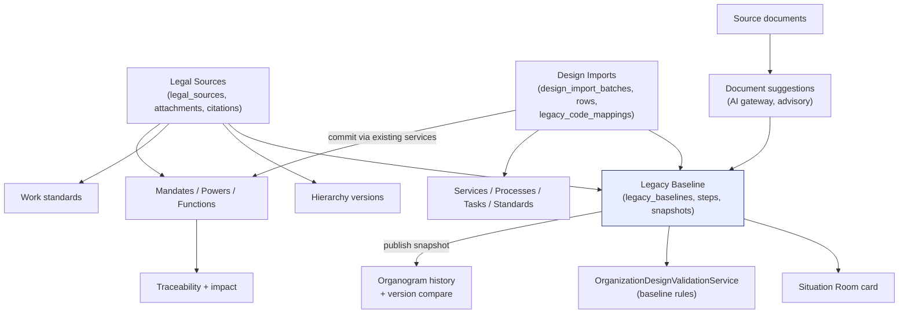

# Organization Design & Workforce Planning — Legacy Baseline Capture: gap map, architecture and ADRs

Brief received 2026-10-19 (sections 0–154; the text was cut at §154 "Import UAT").
This document records what the repository already satisfies, what is missing,
the architecture of the additions, and the decisions taken (ADR-LB-001 …).
It extends [organization-design-workforce-planning-plan.md](organization-design-workforce-planning-plan.md),
whose rulings D-1 … D-13 stay in force.

## 1. Requirements summary

**Functional.** The full design chain (mandate → … → job description) already
exists. The brief adds: a Legal Source master with private attachments; a
Legacy Organization Baseline (status model, immutability, wizard with
server-side progress, validation, review, approval, transactional publication,
supersession); staged Excel/CSV imports for design catalogs with batch and
row-level tracking, legacy-code mapping and idempotent re-runs; a module
landing page and dashboard; organogram derived from the authoritative
structure with history; "as of date" views and version comparison; impact
analysis before changing published upstream records; FTE override evidence;
Situation Room indicators; document-assisted capture that only suggests.

**Non-functional.** No destructive migrations; every record scoped by
`OrganizationScopeService`; maker ≠ checker; PostgreSQL aggregation for
anything that joins employees; queued imports and exports; server-side
pagination; bilingual UI with Gregorian/Ethiopian dates; audited state
changes; IDOR sweep stays green; XSS-safe rich text through the central
sanitizer; private attachment storage with controlled download.

## 2. Gap map (brief section → repository state)

| § | Requirement | State | Action |
|---|---|---|---|
| 3–4 | Golden chain, distinct concepts | **Implemented** (mandates, powers, functions, services, processes, activities, tasks, standards, occupations, professions, specializations, competencies, units, responsibilities, hierarchy versions, manpower plans, position requirements, positions, profiles, JDs) | none |
| 8–9 | Legal Source master + private attachments | **Missing** — mandates carry instrument type/number/reference inline; no attachments | Phase A |
| 10–12 | Mandates, powers, functions | Implemented | add `legal_source_id` citation |
| 13–15 | Services, CPC, ISIC | Implemented; datasets `OFFICIAL_DATASET_REQUIRED` | none |
| 16–22 | Processes, activities, tasks, work standards (versioned, sourced) | Implemented (`position_service_task_standards` with `bpr_reference`, `quality_source`, versions) | optional legal-source citation |
| 23–30 | Occupations/ISCO, professions, competencies, levels | Implemented; scale is a configured catalog (`competency_levels`) | none |
| 31–34 | Unit design, dual relationships, responsibility matrix | Implemented (`organization_unit_relationships`, `responsibility_types.is_exclusive`) | none |
| 35–37 | Structure version, status, validation | Implemented for organizations (`hierarchy_versions`); units unversioned by D-1 | baseline snapshot gives unit-level history (Phase B) |
| 38–39 | Organogram from structure, history | **Partial** — Structure page lists the live unit tree; no historical view, no print | Phase D |
| 40–46 | Workforce planning, FTE decimal, FTE ≠ headcount, gap | Implemented (`calculated_fte` decimal, `approved_headcount`, occupancy from assignments) | none |
| 47–51 | Positions, codes, profiles | Implemented | none |
| 52–56 | Job descriptions, rich text, versions, approval, generation | Implemented | none |
| 57–60 | Traceability, orphans, impact, version impact | Implemented for studies; **impact before new version** of a published upstream record missing | Phase D |
| 5–7, 61–64 | Legacy baseline, statuses, immutability, wizard | **Missing** | Phase B |
| 65 | Manual entry | Implemented | none |
| 66–74 | Staged Excel/CSV import, batches, row errors, templates, identity matching, legacy IDs, no duplicates | **Partial** — classification CSV importer and structure workbook importer exist; no staged import for design catalogs | Phase C |
| 75–77 | Document-assisted capture, no fabrication, AI boundary | **Missing** | Phase E (suggestions only) |
| 78 | Import file security | Pattern exists (structure import request rules) | reuse |
| 79–83 | Scope, permissions, reviewer ≠ approver | Implemented | add new permission groups |
| 84–85 | Audit, review notes | Implemented (`OrganizationDesignAudit`, status history, `review_comment`) | reuse |
| 86–89 | Validation engine, severity, checklist, transactional publish | Implemented (`OrganizationDesignValidationService`) | add baseline rules |
| 90–92 | Effective dates, historical view, comparison | Dates implemented; **as-of and compare missing** | Phase D |
| 93–95 | Duplication, reference data, enum labels | Implemented | none |
| 96–99 | Amharic, English, calendar, rich text | Implemented conventions | follow |
| 100–102 | Sidebar grouping, landing page, dashboard | **Missing** — 15 flat links, no landing | Phase D |
| 103–107 | Traceability view, trees, relationship view, planning UI, calculation details | Implemented | none |
| 108 | FTE override evidence | **Partial** — reason + adjusted_by; no date/source | Phase E |
| 109–112 | Position approval, occupancy, existing employees/positions | Implemented | none |
| 113–118 | Data quality, reports, exports, Amharic PDF | Implemented (17 reports, dompdf with Ethiopic fonts) | add legal-source and baseline reports |
| 119–128 | Scale, pagination, indexes, N+1, import performance | Implemented for the module; imports need queue + chunks | Phase C |
| 129–137 | Integrations | Mostly in place; **Situation Room card missing** | Phase E |
| 138–151 | Security, mass assignment, attachments, soft delete, approval evidence, signoff | Patterns exist; no e-signature in the repo (not invented) | Phase F tests |
| 152–154 | UAT scenarios | **Missing** for baseline and imports | Phase F docs |

## 3. Architecture of the additions

- **Legal sources** are a master record owned by an organization or, when
  `organization_id` is null, city-level reference data. Attachments live on
  the private disk and are downloaded through a controlled route. Any design
  record cites a source through `legal_source_citations` (polymorphic), so
  mandates, standards, methodologies, hierarchy versions and baselines all
  point at the same evidence without schema churn.
- **Legacy baseline** is a *container with a snapshot*, not a copy of the
  chain. It links the organization, its legal sources, the hierarchy version
  and the design records that already exist (detected per wizard step), tracks
  step completion server-side, runs the validation engine, moves through the
  existing `OrganizationDesignStatus` workflow with reviewer ≠ approver, and
  on publication freezes a JSON snapshot (units, relationships, positions,
  establishments, counts per chain stage) inside one transaction. Later
  changes supersede it with a new revision (`lineage_key`, `version_no`).
- **Design imports** stage rows first (`design_import_rows`), validate and
  match by code or legacy code (`legacy_code_mappings`), and only on an
  explicit commit create records through the existing domain services, so
  every business rule and audit entry applies. Processing runs on the queue
  in chunks; the batch is idempotent by file fingerprint and by legacy code.
- **Organogram and history** read the live unit tree for the current state
  and a baseline snapshot for any published baseline; a diff service compares
  two snapshots or two versions of a versioned record.
- **Document suggestions** reuse the Intelligence gateway (`knowledge_documents`
  data class, redaction, breaker). Output is parsed against a strict schema
  into `design_document_suggestions` with `uncertain` flags; a person accepts
  a suggestion to create a *draft* record, or rejects it. Nothing publishes.

## 4. Decisions (ADRs)

### ADR-LB-001 Legal sources are a separate master with polymorphic citations
**Context.** Mandates already hold instrument fields inline; the brief wants a
reusable Legal Source with attachments cited by many record types.
**Decision.** New `legal_sources` + `legal_source_attachments` +
`legal_source_citations(subject_type, subject_id, legal_source_id, note)`.
Mandates gain nullable `legal_source_id`; the inline fields stay for
compatibility and are kept in sync when a source is chosen.
**Alternatives.** Per-table FK columns (schema churn on nine tables);
turning `legal_instrument_types` into the source (it is a type catalog, not
an instance). **Consequences.** One evidence register, one download route,
one report; a join per citation lookup.

### ADR-LB-002 The baseline is a workflow container plus a published snapshot
**Context.** D-1 keeps units unversioned; copying the whole chain into
baseline tables would duplicate canonical data (brief §74).
**Decision.** `legacy_baselines` references existing records; `legacy_baseline_steps`
stores per-step status; `legacy_baseline_snapshots` stores the frozen JSON on
publish. **Alternatives.** Versioned copies of every entity (duplicates,
double maintenance); using `hierarchy_versions` alone (organizations only, no
units/positions). **Consequences.** History and organogram come from
snapshots; the live chain stays single-sourced.

### ADR-LB-003 Reuse `OrganizationDesignStatus`; model the extra states as fields
**Context.** Brief §6 lists DRAFT, IMPORTED, MAPPING_REQUIRED, UNDER_VALIDATION,
UNDER_REVIEW, RETURNED, APPROVED, PUBLISHED, SUPERSEDED but forbids duplicate
statuses. **Decision.** Workflow status uses the existing enum (draft,
under_review, approved, published, superseded, cancelled). `origin`
(manual|imported|mixed), `validation_status` (not_run|passed|warnings|failed),
`mapping_required_count` and `returned_at`/`review_comment` carry the rest;
"Returned" is draft with a review comment, as studies do today.
**Consequences.** One status vocabulary across the module; labels already
translated.

### ADR-LB-004 Imports stage, then commit through domain services
**Context.** Imported data must never become authoritative directly (§68);
rules live in services. **Decision.** Generic `design_import_batches` /
`design_import_rows` with an `entity_type` sheet definition registry;
`ProcessDesignImportBatch` job parses in chunks (PhpSpreadsheet read filter /
CSV stream), validates and matches; `commit` calls `MandateService`,
`FunctionService`, `ServiceCatalogService`, `ProcessArchitectureService`,
`WorkRequirementService` per row in a transaction per chunk, writing
`legacy_code_mappings`. **Alternatives.** Maatwebsite `ToModel` imports
(bypass services); direct inserts (no audit, no validation).
**Consequences.** Slower per row, but every rule holds and re-runs are
idempotent.

### ADR-LB-005 Sidebar collapses to a landing page
**Decision.** The `organizationDesign` sidebar group keeps four entries
(Overview, Legacy Baseline, Imports, Reports); the Overview page offers the
twelve category cards gated by permission, with KPIs from aggregates.
**Consequences.** `AppSidebarNavigationTest` fixtures change; deep links stay
valid.

### ADR-LB-006 Document assistance is advisory and schema-bound
**Decision.** Suggestions come only from the Intelligence gateway under the
`knowledge_documents` data class, parsed against a strict schema, stored with
`uncertain` flags, applied only by a person into draft records.
**Consequences.** Works when the gateway is degraded (the feature simply
shows "unavailable"); never a path to publication.

### ADR-LB-007 FTE override evidence is additive
**Decision.** Add `adjusted_at`, `adjustment_source`, `adjustment_reference`
to `manpower_plan_lines`; the calculated value is never overwritten.

## 5. Permissions (convention `kebab-group.camelAction`)

`legal-sources.{viewAny,view,create,update,delete}`,
`legacy-baselines.{viewAny,view,create,update,review,approve,publish}`,
`design-imports.{viewAny,create,commit}`, `design-suggestions.{view,apply}`.
Default roles: Organization Designer gets viewAny/view/create/update of each;
Organization Design Approver gets review/approve/publish; Design Catalog
Manager manages city-level legal sources. Granted to no other role (policy
decision for the business).

## 6. Phases

| Phase | Scope | Tests |
|---|---|---|
| A | Legal sources, attachments, citations, permissions, pages, report | `LegalSourceTest` |
| B | Legacy baseline: model, workflow, steps, validation rules, publish snapshot, supersede, wizard UI | `LegacyBaselineTest` |
| C | Design imports: batches, rows, mappings, queue job, templates, commit, UI | `DesignImportTest` |
| D | Landing + dashboard, sidebar regroup, organogram history, as-of, compare, impact | `DesignOverviewTest`, `VersionHistoryTest` |
| E | FTE override evidence, Situation Room card, document suggestions, reports | `DesignIntegrationTest` |
| F | Hardening fixtures, UAT and readiness docs, final verdict | `HardeningTest` extension |

## 7. Markers carried forward

`OFFICIAL_DATASET_REQUIRED` ISCO-08 / ISIC Rev.4 / CPC (unchanged);
`NEEDS_POLICY_DECISION_RESPONSIBILITY_MODEL` (responsibility types are a
catalog; no RACI asserted); `NEEDS_POLICY_DECISION_FTE_METHOD` (methodologies
are configurable; none seeded as policy); `NEEDS_POLICY_DECISION_COMPETENCY_SCALE`
(levels catalog shipped empty of policy values); e-signature: none in the
repository, approval evidence is approver + date + reference + attachment.
