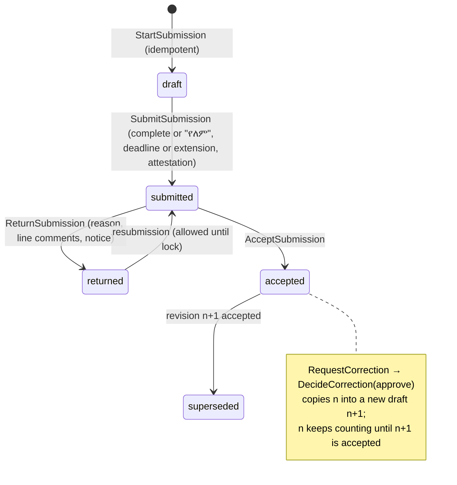

# Service Delivery Monitoring & Support (የአገልግሎት አሰጣጥ ክትትልና ድጋፍ)

The quarterly service-delivery report that every public institution of the Addis Ababa City
Administration submits, its review woreda → sub-city → city, the consolidated official reports, and
the support function around it (support officers, clarifications, monitoring visits, action items,
reminders). It replaces Word tables sent over Telegram, re-sent as stamped photos and re-typed by
coordinators.

- Code: `Modules/ServiceMonitoring` (ADR 0017 layout), routes `routes/service-monitoring.php`,
  pages `resources/js/Pages/ServiceMonitoring`, tests `tests/Feature/ServiceMonitoring`.
- Feature flag: `service_monitoring` (`FEATURE_SERVICE_MONITORING`, default on). Off, every
  `service-monitoring.*` route answers 404, the sidebar group and the Situation Room category disappear.
- Security: [service-monitoring-security.md](service-monitoring-security.md). UAT script:
  [service-monitoring-uat.md](service-monitoring-uat.md).

## Who does what

| Who | Role (default) | Does |
| --- | --- | --- |
| Institution reporter | Service Monitoring Reporter | Prepares the quarterly report of the institution in scope. Cannot attest. |
| Institution head | Service Monitoring Head | Prepares, **attests and submits**; sees Section I names. |
| Sub-city reviewer | Service Monitoring Reviewer | Returns or accepts **woreda** reports in scope, records a woreda as not submitted, **certifies** the sub-city consolidation, exports, answers clarifications. |
| City coordinator | Service Monitoring Coordinator (city-wide) | Fiscal years and schedules, the participant registry, extensions, review of **sub-city and center** reports, **lock / reopen**, exports, settings. Not technology verification. |
| Innovation & Technology Bureau | Innovation & Technology Verifier (city-wide) | Verifies or rejects reported digital services. |
| Support expert (ደጋፊ ባለሙያ) | Support Officer | Answers clarifications of assigned institutions, records visits, findings and action items. |

A role makes a user eligible; the organization must still be inside the user's scope
(`OrganizationScopeService`). City-level duties need city-wide reach (an unrestricted role or a
city-wide scope record).

## Workflow

1. The coordinator creates the fiscal year (`service-monitoring:create-fiscal-year 2019` or the
   Periods page); its four periods get the default schedule.
2. Institutions open their report from the dashboard once the period opens, fill the four sections
   (or mark a section "የለም"), attest and submit before the deadline (end of day, Addis Ababa).
3. The sub-city reviewer returns or accepts each woreda; the city coordinator reviews sub-city and
   center reports. The Innovation & Technology Bureau verifies digital services.
4. When its own report and every woreda is accepted or recorded as not submitted, the sub-city
   certifies its consolidation (a snapshot is stored).
5. When every sub-city has certified, the coordinator locks the period: the city consolidation is
   stored as an immutable snapshot and nothing in the period can change until it is reopened with
   a reason.

## The forms: field → column → source

Form A is for center institutions (one Section I.1 table, "በማዕከል ደረጃ ብቻ"); Form B for sub-city and
woreda institutions (two tables, "በክ/ከተማ ደረጃ ብቻ" and "በወረዳ ደረጃ ብቻ"). Everything below is
defined once in `Domain/Forms/FormDefinition.php`; labels are in `lang/{am,en}/service-monitoring.php`
under `form.` (the Amharic text is the forms' own wording).

| Section | Field / column (Amharic) | Stored in | Source | Aggregation |
| --- | --- | --- | --- | --- |
| I.1 | ተ/ቁ | `accountability_entries.sequence` | derived (row order) | — |
| I.1 | የተቋሙ ስም / ወረዳ | submission organization snapshot | derived | — |
| I.1 | ተጠያቂ የተደረጉ አመራር/ባለሙያ ሙሉ ስም | `full_name` (encrypted) | employee name snapshot, or typed for a customer | flow |
| I.1 | ተጠያቂ የተደረጉበት ምክንያት በዝርዝር | `reason_category`, `reason_detail` (encrypted) | manual | flow |
| I.1 | የተወሰደ የእርምት እርምጃ በዝርዝር | `final_action`, `action_detail` (encrypted) | manual, or a final disciplinary decision | flow |
| I.1 | ተጠያቂ የተደረገው ስራ ድርሻ (X) | `role_category` | manual; prefilled from the position for discipline suggestions | flow |
| I.1 | ምርመራ / ምርመራ/ጽ/ቤት ይጠቀስ/ | `office_name`, `remark` | manual (office required for woredas) | — |
| I.2 | action × role × level, totals | — | **derived** from I.1 (each employee once, latest action) | flow |
| II | የህጻናት ማቆያ / ካፍቴሪያ / የሸማች ሱቅ ብዛት | `institution_building.*_count` | manual (cafeteria: system reference shown) | flow |
| II | የባለጉዳይ ማረፍያ ቁጥር / የሚይዘው ሰው ብዛት | `waiting_area_count`, `waiting_area_capacity` | manual | stock |
| II | አስተያየት መስጫ ሳጥን, ኤልዲ, አቅጣጫ ጠቋሚ | `suggestion_box_count`, `led_count`, `signage_count` | manual | stock |
| II | አጠቃላይ ሰራተኛ ብዛት ሹፌር ሳይጨምር | `employees_excl_drivers` | **prefilled** (current assignments minus driver occupations), override reason ≥ 10 | stock |
| II | የደረት ባጅ ብዛት ሹፌር ሳይጨምር | `chest_badges_excl_drivers` | **prefilled** (active/issued ID cards of those employees), override reason ≥ 10 | stock |
| II | የጠረጴዛ ባጅ ብዛት | `desk_badges` | manual | stock |
| II | ስልጠና/መድረክ ብዛት, ተሳታፊ ተገልጋይ ብዛት | `awareness_trainings`, `awareness_participants` | manual | flow |
| II | ልዩ ድጋፍ የሚፈልጉ ተገልጋዮች በተመለከተ | `submissions.special_support_narrative` | manual | latest |
| III | የተቋሙ ዋና / ንዑስ አገልግሎት ብዛት | `service_totals.main_total`, `sub_total` | manual; the catalog count is shown | stock |
| III | ዋና / ንዑስ አገልግሎቶች ብዛት (digital) | — | **derived**: verified rows by level | flow |
| III | የአገልግሎት ስም, የቴክኖሎጂው አይነት/የሲስተሙ ስም, የሲስተም ብዛት, ምርመራ | `digital_services` | catalog link or free text (catalog gap) | flow |
| IV | ዋና / የንዑስ አገልግሎት ብዛት | `service_totals` | as Section III | stock |
| IV | ከስታንዳርድ በላይ / በስታንዳርድ / በታች (main, sub) | `standard_performance.*` | manual; above + at + below = total | flow (sum and latest quarter) |
| IV | ምክንያት, የተወሰደ እርምጃ | `below_reasons`, `actions_taken` | manual; ≥ 20 characters when anything is below standard | latest |

## Form templates

The official forms change from period to period, and many kinds of institutions report, not only
"center", "sub-city" and "woreda". So the form an institution fills is shaped in the UI
(**Form templates**, `service_monitoring.forms.manage`, city-wide), never in code:

- A **form template** is versioned: `draft → published → superseded → archived`. Only a draft
  changes. **New version** copies a version into the next draft (one draft per code); **Copy as new
  template** starts an independent one; a draft no report started on can be discarded.
- A template is assigned to **organization types**. An organization type belongs to at most one
  published template, so every participant has exactly one form. Types without a template, and
  every report started before one was published, use the official form unchanged.
- A template changes the official form in three ways (`Domain/Forms/TemplateContent`):
  1. **Wording**: the form title, the general notes, and each official section's title and notes.
     An empty value keeps the official text.
  2. **Official sections on or off**: a section left out is not shown, not validated, and not
     required at submission. The sections that stay keep all their rules (identity, prefill,
     verification, sums, I.2 derivation).
  3. **Additional sections** (`Domain/Forms/FormSchema`): tables (rows entered by the
     institution, fixed rows, or one row), typed columns (text, number, "X" mark, choice, row
     total), grouped headings, notes and text answers. A number column is `flow` (summed over the
     quarters of a range) or `stock` (latest quarter), like the Section II fields (D4).
- `StartSubmission` pins the participant's published template on the report
  (`service_monitoring_submissions.form_template_id`); corrections copy it with the revision.
  Answers to additional sections are stored in `custom_data`, normalized and re-totalled by the
  server, and required answers are enforced at submission (`SubmissionValidator::CUSTOM`).
- **Consolidated figures** of the additional sections (`CustomSectionSummary`,
  `GET /forms/{template}/summary`) read accepted revisions only, inside the viewer's scope, and
  break fixed-row tables down by the organization types that reported, never by a built-in
  administrative level.
- The official XLSX/PDF exports keep the official layout; additional sections are not exported yet.

## Aggregation (D3, D4, D24)

- Institutions report **one quarter each**. The official 3-, 6-, 9-month and annual reports are
  derived (`ConsolidationService::report`), so they reconcile by construction.
- **Flow** figures are summed over the quarters of the range; **stock** figures take the latest
  quarter of the range with an accepted report. Section IV shows the sum and the latest quarter.
- Section I.2 counts each employee **once in the range, by the latest action date**; customer rows
  count per row.
- Only the **accepted** revision counts. Drafts, returned, submitted and superseded revisions never do.
- Per period, figures come from set-based queries over the accepted revisions (one query per
  section, digital counts grouped in SQL; ~4 queries per period whatever the number of
  institutions), or from the **period-lock snapshot** once the period is locked. A snapshot whose
  checksum fails is refused.

## Decisions

D1–D27 are the specification's decisions, implemented as written. The table lists how each one is
realized and the decisions taken during the build (D28 onward), with the reason.

| # | Topic | Implementation |
| --- | --- | --- |
| D1 | Identifiers | `service_monitoring` everywhere; the Situation Room `service_delivery` category is untouched. |
| D2 | Fiscal year | `FiscalCalendar` over `EthiopianCalendarService`; no Gregorian date is hard-coded. |
| D3 | Entered vs derived | One report per quarter; ranges derived. |
| D4 | Flow / stock | `FormDefinition::SECTION_2` and `aggregationOf()`. |
| D5 | Deadlines | `FiscalCalendar::defaultSchedule()`; the coordinator edits them on the period page. |
| D6 | Late submission | `SubmissionGuard::lateUnder()`; extensions with a ≥ 20-character reason, revocable, audited; "late (extension)" in compliance. |
| D7 | Participants | Registry with one active row per organization (Action + partial unique index); `service-monitoring:suggest-participants {--apply}`. |
| D8 | Review chain | Woreda → sub-city scope; sub-city and center → city-wide reach; certification; lock. |
| D9 | States | `SubmissionStateMachine`; corrections create revision n+1; reopen needs `periods.reopen` and a reason. |
| D10 | "የለም" | Per-section flags; flagged sections must be empty; Section II flags zero the flows. |
| D11 | Attestation | `attest` permission, declaration tick, snapshots; stamped copy optional unless the setting says so. |
| D12–D15 | Section I | Identity rules, final action, one row per employee, cross-quarter confirmation, I.2 derived. |
| D16 | Discipline | `AccountabilitySuggestionService`, read-only. |
| D17 | Role headers | `form.summary_roles.{A,B}`: Form A "ሹመኛ/ሜሪት+ሹመት/", Form B "ሹመኛ አመራር". |
| D18, D19 | Section II prefill | `PrefillService`; the rule label is shown on Form B only. |
| D20 | Section III | Catalog link or gap; main → sub tree in the module; FY rule; verification. |
| D21 | Section IV | Sum and text checks (`SubmissionValidator::section4Problems`). |
| D22 | Support | Support assignments, clarifications, visits, findings, action items. |
| D23 | Reminders | `ReminderService` + daily job; idempotent log. |
| D24 | Snapshots | `consolidation_snapshots` at certification and lock, sha256 checksum, immutable model. |
| D25 | Exports | Queued XLSX/PDF in the official layout (`OfficialFormLayout`); names only with `export_named`. |
| D26 | Situation Room | Category `service_monitoring` through the module contract `ServiceMonitoringIndicators`. |
| D27 | Privacy | Names masked without `view_named`; every named view audited. |
| D28 | Module location | `Modules/ServiceMonitoring` with the six layers (ADR 0017), not `app/…` as the specification listed: the repository moved its modules there; other modules are used only through public contracts (Cafeteria's `CafeteriaDirectory`). |
| D29 | Revisions and "current" | `is_current` marks the working revision; a second partial unique index allows one **accepted** revision per participant and period. A correction draft is current while the accepted revision still counts. |
| D30 | Resubmission after return | Allowed until the period is locked: the deadline applies to the first submission only. A return is the reviewer reopening the report. |
| D31 | Lock precondition | The coordinator can lock only when every sub-city has certified (the certification is the sub-city's sign-off). |
| D32 | Non-submission record | New table `service_monitoring_non_submissions`, so "formally recorded as not submitted" (D8) is a record, not a missing row. |
| D33 | Exports table | New table `service_monitoring_exports` for queued exports (the `PublicFeedbackReportExport` pattern). |
| D34 | Discipline "final" | Latest decision of the case, action approve/modify with a penalty, **delivered** (Art. 28(3)), case status `decision_delivered` or `closed`; the delivery date (Addis) is the action date. Role prefill: unit-head position → merit leader; other positions → professional; no position → left to the user. |
| D35 | Cafeteria reference | The organization's own active cafeteria locations through the public `CafeteriaDirectory` contract; the access table is Cafeteria's private data. |
| D36 | Catalog hierarchy | The service catalog has no parent/child relation, so sub services point at a main row of the same submission (`parent_entry_id`). Section IV totals default to the catalog count as a hint shown beside the input. |
| D37 | Reminder timing | `missing_after_due` is sent the day after the deadline (once); `action_item_overdue` the day after the due date, then weekly. |
| D38 | Form text not given verbatim | The specification gives the I.1 heading with an ellipsis ("ተጠያቂ የተደረጉ … ተቋማት"), and the I.2 rules (a)–(c) and the six general notes only in English. The ellipsis is filled per form ("የማዕከል" / "የክ/ከተማና የወረዳ") and the notes are Amharic renderings: **NEEDS_FORM_TEXT_CHECK** against the printed forms before go-live. The verbatim labels keep the forms' spelling; the terminology audit allows it for `service-monitoring.form.*` and the three enum groups that print form text. |
| D39 | City-wide reach | A user is city-wide when unrestricted by the scope service or holding an active city-wide scope record. The Coordinator and Verifier default roles are global. |
| D40 | Named data and City Admin | `accountability.view_named` and `export_named` are withheld from City Admin and Public Service Bureau Admin, like discipline and field-work location data. |
| D41 | Pages without `periods.manage` | Every module user may read the periods page; only the coordinator edits. |
| D42 | Policies | One policy per aggregate root (period, participant, submission, digital service, clarification, visit, action item, attachment, export, settings), as Field Work has one policy for its request and child rows. Section rows, prefill, comments, corrections, histories and snapshots are authorized through their parent's policy. |
| D43 | Phases and commits | The six phases were delivered in two commits (backend for phases 1–5 with their tests; pages, exports, Situation Room, demo data and docs), each with the module tests, Pint, typecheck, the i18n audit and the build passing. |
| D44 | Form templates | Forms are configured, not coded: versioned templates assigned to organization types re-word or leave out official sections and add new ones (§Form templates). Additive: without a template the official form is unchanged. |
| D45 | One template per type | Publishing refuses a template whose organization types already belong to another code's published template, so a participant never has two forms. |
| D46 | Level-neutral wording | Admin screens name the review chain generically (independent institution, parent institution, reporting unit; parent-institution and overall consolidation) instead of center / sub-city / woreda / city. The printed official form text is unchanged and is re-worded per template. |

## Routes

All under `/service-monitoring`, names `service-monitoring.*`, middleware `auth, verified, mfa,
force.password, admin.access`, throttled writes. `php artisan route:list --name=service-monitoring`
lists the module's routes; the main ones:

| Page | Route |
| --- | --- |
| Dashboard | `GET /` |
| Periods, period | `GET /periods`, `GET /periods/{period}` (schedule, extensions, lock, reopen) |
| Registry | `GET /participants` |
| Reports | `GET /submissions`, `GET /submissions/{s}/edit`, `GET /submissions/{s}` |
| Review | `GET /review`, `POST /submissions/{s}/return|accept|comments|corrections` |
| Consolidation | `GET /consolidation/sub-city`, `GET /consolidation/city`, certify, not-submitted |
| Verification | `GET /verification`, `POST /digital-services/{d}/verify|reject` |
| Support | `/clarifications`, `/visits`, `/action-items` |
| Reports, exports | `GET /reports`, `POST /exports`, `GET /exports/{e}/download` |
| Settings | `GET|PUT /settings` |
| Form templates | `GET /forms`, `/forms/create`, `/forms/{t}`, `/forms/{t}/edit`, `/forms/{t}/summary`; `POST /forms/{t}/publish|new-version|duplicate|archive` |

## Permissions and roles

`database/seeders/data/service-monitoring-permissions.php` (category "Service Delivery Monitoring"),
registered by `2026_10_30_200100_register_service_monitoring_permissions.php`; role sets in
`Modules/ServiceMonitoring/Contracts/Data/ServiceMonitoringRoles.php`.

| Permission | Reporter | Head | Reviewer | Coordinator | Verifier | Support |
| --- | :-: | :-: | :-: | :-: | :-: | :-: |
| view | ✓ | ✓ | ✓ | ✓ | ✓ | ✓ |
| submit | ✓ | ✓ | | ✓ | | |
| attest | | ✓ | | ✓ | | |
| review, consolidate | | | ✓ | ✓ | | |
| periods.manage, periods.reopen, participants.manage, extensions.grant, settings.manage | | | | ✓ | | |
| accountability.view_named | | ✓ | ✓ | ✓ | | |
| accountability.export_named | | | | ✓ | | |
| technology.verify | | | | | ✓ | |
| support.respond | | | ✓ | ✓ | | ✓ |
| visits.manage | | | | ✓ | | ✓ |
| reports.view | | | ✓ | ✓ | ✓ | ✓ |
| reports.export | | | ✓ | ✓ | | |
| forms.manage | | | | ✓ | | |

## Audit events

`App\Enums\AuditEventType::ServiceMonitoring*` (`service_monitoring.*`): fiscal_year_created,
schedule_updated, period_locked, period_reopened, participant_registered, participant_updated,
support_assigned, extension_granted, extension_revoked, submission_started, section_saved,
entry_deleted, prefill_captured, stamped_copy_uploaded, submitted, returned, accepted,
correction_requested, correction_decided, review_comment_added, digital_service_verified,
digital_service_rejected, certified, non_submission_recorded, clarification_opened,
clarification_replied, clarification_closed, visit_saved, finding_added, action_item_saved,
action_item_evidence_added, settings_updated, export_requested, exported, export_downloaded,
named_data_viewed, attachment_downloaded. Section I audit entries hold categories and ids, never
names or details.

## Reminders

`service-monitoring:send-reminders` runs daily at 06:15 (routes/console.php) and queues
`SendServiceMonitoringReminders`. Kinds: `period_opened` (opens_on), `due_in_3_days`, `due_today`
(to those not yet submitted), `missing_after_due` (the day after, to submitters and reviewers),
`returned` (at once), `action_item_overdue` (day after due, then weekly). In-app and email follow the
notification settings; SMS through `SmsGateway` only when configured and the user has a phone.
`service_monitoring_reminder_logs` keeps one row per (participant, subject, type, day).

## Exports

`POST /exports` queues `GenerateServiceMonitoringExport`: XLSX (one sheet per section I.1, I.2, II,
III, IV and the notes) or PDF (landscape A4, embedded document fonts), for one submission, a
sub-city consolidation or the city consolidation, for a quarter or the 6-, 9-month and annual
ranges. Same headings, groupings, ተ/ቁ, totals rows and printed notes as the forms; the issuing
organization's letterhead and seal when it has them (city exports: the organization chosen in
settings). Text cells are written as text (never formulas). Without `export_named` the role label
replaces names and the categories replace the details. Files land on the private disk and download
only for the requester; request, build and download are audited.

## Demo data

`DemoServiceMonitoringSeeder` (part of `DemoDataSeeder`): FY 2019, DEMO Arada Sub-city with two
woredas and the demo Civic Services Bureau as a center institution; Q1 reports accepted, submitted
and returned, a Q2 draft.
